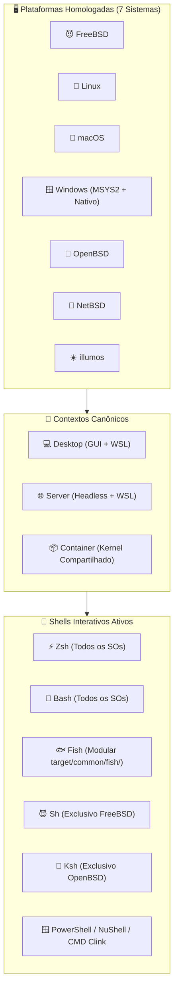
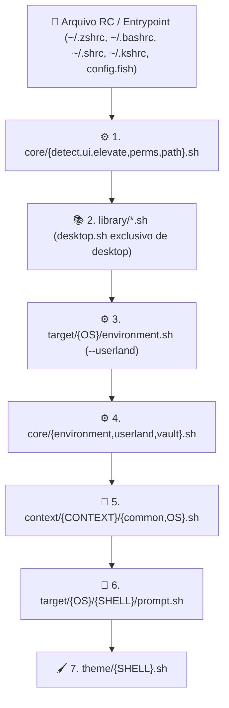

# 🐚 Universal Shell Environment

> Configurações, aliases e prompts centralizados para todos os seus ambientes de sistema, mantendo a experiência consistente seja no Desktop, Servidor, Contêiner ou WSL. Componente de runtime interativo do **Quarteto de Produtividade**, construído sobre o **Triângulo Dourado de Engenharia: o equilíbrio perfeito entre Estabilidade inabalável, Eficiência extrema (< 20ms) e Conveniência ergonômica**.

---

### 🏛️ O Quarteto de Produtividade

[](https://github.com/GabrielFrigo4/setup)
[](https://github.com/GabrielFrigo4/shell)
[](https://github.com/GabrielFrigo4/vault)
[](https://github.com/GabrielFrigo4/profile)

> 📖 **Arquitetura Unificada do Ecossistema:** Conheça a matriz completa de responsabilidades, ciclo de boot e segregação de privilégios em [ENVIRONMENT.md](ENVIRONMENT.md).
> 📜 **Princípios de Engenharia:** Conheça os 22 princípios de engenharia UNIX + Clean Code em [PRINCIPLES.md](PRINCIPLES.md).
> 🗺️ **Roadmap & Status do Projeto:** Acompanhe o planejamento e a matriz de status em [TODO.md](TODO.md).
> 🤝 **Guia de Contribuição & Setup:** Instruções de bancada, ganchos Git e quality gates em [CONTRIBUTING.md](CONTRIBUTING.md).

---

### 🖥️ Sistemas, Contextos & Shells

[](https://github.com/GabrielFrigo4/shell/actions/workflows/ci.yml)
[](TODO.md)
[](CONTRIBUTING.md)

**Plataformas Homologadas:**<br>


**Shells Interativos Suportados (`zsh` ≫ `bash` ≫ `fish` / `sh` / `ksh` & Nativos Windows):**<br>


**Shells Não Suportados para Uso Interativo (Roteamento Automático):**<br>




#### 🐚 Matriz de Suporte a Shells

| Shell                          |      Status       | Detalhes & Decisão de Arquitetura                                                                                                                                          |
| :----------------------------- | :---------------: | :------------------------------------------------------------------------------------------------------------------------------------------------------------------------- |
| **Zsh (`zsh`)**                |      🟢 100%      | Shell primário interativo moderno. Autocompletion com Tab e setas (`menu select`), `_theme_ps1_*` + escape `%` anti-injeção e histórico estendido em todas as plataformas. |
| **Bash (`bash`)**              |      🟢 100%      | Suporte universal em Linux, macOS, FreeBSD, OpenBSD, NetBSD, illumos e Windows MSYS2. Readline interativo e guarda `promptvars`.                                           |
| **Fish (`fish`)**              |      🟢 100%      | Suporte modular completo em `target/common/fish/` (`config.fish`, `prompt.fish`, `ui.fish`, `aliases.fish`), instalado via `install.sh -s fish` com `PYTHONPYCACHEPREFIX`. |
| **FreeBSD `sh`**               |      🟢 100%      | Shell POSIX fundamental (**exclusivo do FreeBSD `/bin/sh`**). Mini prompt calibrado (128B/192B), `libedit` e fallback TTY puro.                                            |
| **OpenBSD `ksh`**              |      🟢 100%      | Shell nativo auditado (**exclusivo do OpenBSD `/bin/ksh`** `pdksh`). Delimitadores `\x01\r`, escapes hex `\x1b` e bindings Emacs canônicos.                                |
| **PowerShell / NuShell / CMD** |      🟢 100%      | Targets nativos Windows (`target/windows/`): `.NET` lazy Chocolatey no `pwsh`, `ENV_CONVERSIONS` dual no `nu`, `autorun.cmd` + Clink zero-`io.popen` no `cmd`.             |
| **Dash (`dash`)**              | ⛔ Não Interativo | BNF estrita proíbe funções `kebab-case` (`-`) e sintaxe `$'\e'`. `_detect_enabled_shell` ignora `dash` e `install.sh` promove/roteia para `zsh`/`bash`.                    |
| **NetBSD `/bin/sh` (`ash`)**   | ⛔ Não Interativo | Shell mínimo de base sem suporte ao conjunto interativo completo. Guardas de compatibilidade e `install.sh` promovem/roteiam sessões interativas para `zsh`/`bash`.        |

> 💡 **O Caso do FreeBSD `sh` & Engenharia Cirúrgica de Prompt:**
> O `sh` do FreeBSD opera sobre a biblioteca `libedit` e possui um buffer estático em C (`#define PROMPTLEN 192` em FreeBSD 14+ e `128` em <= 13 em `bin/sh/parser.c`), sem `malloc` dinâmico para garantir estabilidade no modo monousuário. O parser em C converte `\[` e `\]` para `\x01` (1B) e `\e` para `0x1b` (1B), tornando a ocupação real em C menor do que a contagem bruta de caracteres da string. O motor dinâmico em `theme/sh.sh` calibra com precisão cirúrgica de bytes dois layouts: **`pill`** (192B) e **`micro`** (128B com fallback automático), aproveitando até 98% do buffer físico com texto útil (pastas e branches completas) sem estouro de memória. Detalhes completos em [docs/THEMES.md](docs/THEMES.md).

---

## 🚀 Instalação Rápida

O instalador é **multi-shell automático**: ao ser executado, ele detecta os shells suportados instalados na máquina e configura todos eles em lote:

- **FreeBSD:** configura `zsh`, `bash`, `sh` e `fish` (caso instalados).
- **OpenBSD:** configura `zsh`, `bash`, `ksh` e `fish` (caso instalados).
- **Linux:** configura `zsh`, `bash` e `fish` (caso instalados).
- **macOS:** configura `zsh`, `bash` e `fish` (caso instalados).
- **Windows (MSYS2 + Nativo):** configura `zsh`, `bash` e `fish` no MSYS2, além dos perfis nativos `pwsh`, `nu` e `cmd` (Clink).
- **NetBSD:** configura `zsh`, `bash` e `fish` (caso instalados; sessões em `/bin/sh`/`ash` são promovidas/roteadas para `zsh`/`bash`).
- **illumos:** configura `zsh`, `bash` e `fish` (caso instalados).

> 💡 **Novo shell instalado depois?** Se você instalar um novo shell posteriormente (ex: `sudo pacman -S zsh` ou `pkg install zsh`), basta executar `reinstall-shell` (ou reexecutar o `install.sh`) e ele configurará o novo shell automaticamente!

### 🗺️ Matriz de Caminhos de Instalação do Shell

| Localização Canônica         | Escopo / Privilégios           |  Status & Recomendação   | Casos de Uso & Contexto                                                                               |
| :--------------------------- | :----------------------------- | :----------------------: | :---------------------------------------------------------------------------------------------------- |
| **`/usr/local/share/shell`** | Global / FHS (`root` / `sudo`) | 🟢 **Padrão de Sistema** | Estações de trabalho e servidores administrados onde `root` e admin compartilham o mesmo runtime.     |
| **`~/.local/share/shell`**   | XDG Data (Rootless)            |    ⭐ **Recomendado**    | Ambientes rootless, Linux, FreeBSD, macOS e MSYS2 com isolamento completo de usuário.                 |
| **`~/.config/shell`**        | XDG Config (Rootless)          |  🔵 **Alternativa XDG**  | Usuários que preferem manter todas as configurações de ferramentas centralizadas sob `~/.config`.     |
| **`~/.shell`**               | Home Direta (Clássico UNIX)    |  ⚪ **Fallback Legado**  | Servidores antigos, ambientes restritos sem suporte XDG ou preferência por dotdir na raiz da `$HOME`. |

---

### 🐧 Unix & 🪟 MSYS2 (Modo Rootless — Recomendado)

A abordagem recomendada privilegia a independência de usuário e zero acoplamento administrativo (`sudo`):

#### Opção A: XDG Data (Canônico Rootless — Recomendado)

```sh
git clone "https://github.com/GabrielFrigo4/shell" "${HOME}/.local/share/shell"
sh "${HOME}/.local/share/shell/install.sh" --context desktop
```

#### Opção B: XDG Config (Ergonomia unificada sob ~/.config)

```sh
git clone "https://github.com/GabrielFrigo4/shell" "${HOME}/.config/shell"
sh "${HOME}/.config/shell/install.sh" --context desktop
```

#### Opção C: Home Direta (Fallback Clássico UNIX / Ambientes Legados)

```sh
git clone "https://github.com/GabrielFrigo4/shell" "${HOME}/.shell"
sh "${HOME}/.shell/install.sh" --context desktop
```

---

### 🏛️ Linux / 😈 FreeBSD / 🍎 macOS (Modo Global de Sistema — Padrão com Sudo)

Padrão em estações de trabalho e servidores administrados onde o par `root` + usuário administrador compartilha a mesma pilha de terminal:

```sh
sudo git clone "https://github.com/GabrielFrigo4/shell" "/usr/local/share/shell"
sh "/usr/local/share/shell/install.sh" --context desktop
```

### ⚙️ Opções do Instalador

| Opção         |      Atalho      | Valores                                                        |   Padrão   | Descrição                                                                                           |
| :------------ | :--------------: | :------------------------------------------------------------- | :--------: | :-------------------------------------------------------------------------------------------------- |
| `--context`   |       `-c`       | `desktop`, `server`, `container`                               | `desktop`  | Perfil de contexto do ambiente (`desktop-*` carrega apenas quando `desktop`).                       |
| `--shell`     |       `-s`       | `all`, `zsh`, `bash`, `sh`, `ksh`, `fish`, `pwsh`, `nu`, `cmd` |   `all`    | Instala em todos os shells detectados ou em um alvo específico.                                     |
| `--userland`  |       `-u`       | `default`, `gnu`, `bsd`                                        | `default`  | Governa a precedência GNU vs. BSD no `$PATH`, grava `SHELL_USERLAND` em `~/.profile`/`config.fish`. |
| `--framework` | `--oh-my-shell`  | Flag booleana                                                  | Desativado | Habilita frameworks externos de terceiros (Oh-My-Zsh / Oh-My-Bash).                                 |
| `--pure`      | `--no-framework` | Flag booleana                                                  |  Ativado   | Modo padrão: templates standalone nativos, zero overhead e boot instantâneo.                        |

> 💡 **Segregação Userland (`--userland=default|bsd|gnu`) & Permissões Canônicas:**
> Em modo `default` ou `bsd`, diretórios GNU (`gnubin` / `/usr/gnu/bin`) nunca precedem as ferramentas nativas do sistema no `$PATH` (evitando sequestro acidental de `ls`, `stat` e utilitários BSD/illumos). Em modo `gnu`, diretórios GNU reais são inseridos antes das ferramentas de sistema (preservando `~/.local/bin` na frente) acompanhados de cache de aliases `g*` validados por `--version` e suporte a `gls` via `_shell_ls`. O `install.sh` também garante `0755` apenas nos entrypoints com `#!` (`shell.sh`, `init.sh`, `install.sh`, `benchmark.sh`, `.githooks/*` e scripts em `.scripts/`) e `0644` em todas as bibliotecas `sourced` e documentações.

---

## ⚡ Comandos Mais Usados

| Comando / Alias                                                                   | Ação                                                                                                                                                | Destino                    |
| :-------------------------------------------------------------------------------- | :-------------------------------------------------------------------------------------------------------------------------------------------------- | :------------------------- |
| `update-all` / `upall` / `u`                                                      | **Orquestrador Global:** Atualiza SO + AUR + Flatpak + Snap + MAS.                                                                                  | Universal                  |
| `update-system` / `upsys`                                                         | Atualiza pacotes do sistema operacional nativo.                                                                                                     | Universal                  |
| `update-shell` / `upsh`                                                           | Atualiza o repositório ativo do shell (`/usr/local/share/shell`, `~/.local/share/shell`, `~/.config/shell` ou `~/.shell`), limpa cache e recarrega. | Universal                  |
| `update-editors` / `uped`                                                         | Atualiza as configurações residentes ativas dos editores (`~/.emacs.d`, `~/.config/nvim`, etc.).                                                    | Universal                  |
| `update-emacs-modes` / `upmodes`                                                  | Sincroniza diretamente os submódulos Elisp locais (`~/.emacs.d/usr/local/*`) com o upstream remoto.                                                 | Universal                  |
| `update-profile` / `uprc` / `sync-profile`                                        | Atualiza o repositório do profile (`~/.local/share/profile` ou `~/.config/profile`), reaplica dotfiles/skills e recarrega `~/.profile`.             | Universal                  |
| `reinstall-shell` / `resh`                                                        | Reexecuta o instalador em todos os shells instalados no SO.                                                                                         | Universal                  |
| `clean-cache` / `ccache`                                                          | Limpa o cache em memória e tmpfs de todos os detectores do ambiente.                                                                                | Universal                  |
| `clean-system` / `cleansys` / `clearsys` / `sysclean` / `syscls` / `clear-system` | Limpa pacotes órfãos (autoremove), dependências obsoletas e caches de pacotes.                                                                      | Universal                  |
| `update-vault` / `upvt`                                                           | Sincroniza segredos (`~/.vault`) e recarrega chaves SSH.                                                                                            | Universal                  |
| `bench-shell` / `bsh` / `shell-bench`                                             | Mede a latência de inicialização dos shells e módulos isolados.                                                                                     | Universal                  |
| `update-wifi` / `upwf`                                                            | Sincroniza credenciais Wi-Fi configuradas com o SO.                                                                                                 | Linux, BSD, Windows        |
| `update-network` / `upnet`                                                        | Valida conectividade e sincroniza credenciais de rede.                                                                                              | Universal                  |
| `editor [alvo]` / `e`                                                             | Abre o editor padrão configurado na cascata de prioridade.                                                                                          | `$VISUAL` / `$EDITOR`      |
| `open-neovim` / `on`                                                              | Abre o Neovim no alvo especificado (padrão: `.`).                                                                                                   | `nvim`                     |
| `open-helix` / `oh` / `h`                                                         | Abre o Helix no alvo especificado (padrão: `.`).                                                                                                    | `hx`                       |
| `emacs-client` / `ec` / `.scripts/emacs-client`                                   | Abre o Emacs GUI com sondagem de saúde (`timeout 2`) e recuperação segura do socket/daemon.                                                         | `emacsclient` / `.scripts` |
| `emacs-open` / `oe`                                                               | Abre o Emacs GUI no alvo especificado (padrão: `.`).                                                                                                | `emacsclient`              |
| `emacs-nw` / `en` / `enw`                                                         | Abre o Emacs no terminal (`emacsclient -t`) sem alvo padrão (espelho de `emacs-client` / `ec`).                                                     | `emacsclient -t`           |
| `emacs-open-nw` / `oen` / `oenw`                                                  | Abre o Emacs no terminal no alvo especificado (padrão: `.`) (espelho de `emacs-open` / `oe`).                                                       | `emacsclient -t`           |
| `open-code` / `oc`                                                                | Abre o VS Code no alvo especificado (padrão: `.`).                                                                                                  | `code` / `vscode`          |
| `mount-device` / `mntdev` / `mdev`                                                | Monta celular em `~/Device` via GVfs/KIO-FUSE/GSConnect/ADB.                                                                                        | Desktop                    |
| `umount-device` / `umdev` / `udev`                                                | Desmonta e desconecta `~/Device` com segurança.                                                                                                     | Desktop                    |
| `ports` / `p`                                                                     | Inspeciona portas de rede em escuta (`ss` > `netstat` > `sockstat`)                                                                                 | Servidor / Desktop         |
| `services` / `svc`                                                                | Inspeciona status dos serviços (`systemctl` > `service` > `rc-status`)                                                                              | Servidor / Desktop         |
| `l`, `ll`, `la`, `lt`                                                             | Listagem moderna com ícones e status git (`eza`/`exa`/`ls`) em TTY; saída pura em pipe.                                                             | Universal                  |
| `g <termo>`                                                                       | Busca inteligente de texto em arquivos (`rg` > `grep`).                                                                                             | Universal                  |
| `c <arquivo>` / `b`                                                               | Visualizador formatado com syntax highlighting (`bat` > `cat`).                                                                                     | Universal                  |
| `f <alvo>` / `ff`                                                                 | Localizador ultrarrápido de arquivos (`fd` > `find`).                                                                                               | Universal                  |
| `freebsd` / `fb [start \| stop \| status \| console \| ssh]`                      | Orquestrador FreeBSD: VM KVM (Linux Host) ou Jail nativa Bastille (FreeBSD Host).                                                                   | Linux, FreeBSD             |
| `linux` / `lx [start \| stop \| status \| console \| ssh]`                        | Orquestrador Linux: Container Incus LXC (Linux Host) ou VM Bhyve Debian (FreeBSD Host).                                                             | Linux, FreeBSD             |
| `openbsd` / `ob [start \| stop \| status \| console \| ssh]`                      | Orquestrador OpenBSD: VM OpenBSD no KVM (Linux Host) ou Bhyve (FreeBSD Host).                                                                       | Linux, FreeBSD             |
| `netbsd` / `nb [start \| stop \| status \| console \| ssh]`                       | Orquestrador NetBSD: VM NetBSD no KVM (Linux Host) ou Bhyve (FreeBSD Host).                                                                         | Linux, FreeBSD             |

> 📖 **Consulte o catálogo completo de atalhos e variáveis em [docs/ALIASES.md](docs/ALIASES.md).**

---

## 🔤 Tipografia & Requisitos de Terminal

Para a renderização visual precisa dos prompts, glifos do Powerline (``, ``, ``) e ícones de status (``, ``, ``, `󰣆`, ``, `󰊢`):

- **Fonte Oficial Homologada:** **`JetBrainsMono Nerd Font`** (versão 3.x+). Suas hastes de peso 400 (15% mais encorpadas) e proporções de célula fornecem alinhamento geométrico perfeito com Box-Drawing e Powerline.
- **Suporte a Cores:** Terminal com suporte a ANSI 256 colors ou TrueColor (24-bit).
- **Emuladores Recomendados:** Alacritty, Kitty, WezTerm, Foot, Windows Terminal.

---

## 📚 Documentação Técnica Completa

Para aprofundar na arquitetura, comportamentos por contexto e motores de detecção:

- 🏛️ **[docs/ARCHITECTURE.md](docs/ARCHITECTURE.md)**: Ciclo de vida da sessão interativa, cascata de sourcing e orçamento de latência (&lt; 64ms).
- 🎯 **[docs/CONTEXTS.md](docs/CONTEXTS.md)**: Especificação dos perfis `desktop`, `server` e `container` (com auto-detecção WSL).
- 🧠 **[docs/DETECTION.md](docs/DETECTION.md)**: Reconhecimento de SOs, famílias de distros Linux, dark mode (D-Bus/XDG Portal) e integração GTK/Qt/Electron.
- 🖌️ **[docs/THEMES.md](docs/THEMES.md)**: Contratos visuais dos prompts (Zsh, Bash, Sh, Ksh, Fish), paleta ANSI e fallback para TTYs puros.
- 🗺️ **[docs/ALIASES.md](docs/ALIASES.md)**: Dicionário exaustivo de comandos públicos, atalhos e variáveis de ambiente.

---

## 📁 Estrutura do Repositório



- 🐚 **`shell.sh` / `init.sh`**: Interface unificada de componente e entrypoint executável (`0755`) com carregamento condicional de `library/desktop.sh` restrito a `SHELL_CONTEXT=desktop` e sub-módulos _lazy_ (`desktop/{device,kiosk,session}.sh`).
- 🔧 **`.scripts/`**: Wrappers executáveis (`0755`) como `.scripts/emacs-client` (com probe de saúde `timeout 2` e recuperação automática de socket/daemon).
- ⚙️ **[core/](core/README.md)**: Os 9 módulos fundacionais e interativos do shell (`detect.sh`, `ui.sh`, `elevate.sh`, `perms.sh`, `path.sh`, `deploy.sh`, `environment.sh` com `PYTHONPYCACHEPREFIX`, `userland.sh` e `vault.sh`).
- 📚 **[library/](library/README.md)**: Biblioteca padrão (`0644`) organizada em 5 dispatchers de domínio com subpastas especializadas (`desktop/`, `system/`, `functions/`, `ecosystem/`, `hypervisor/`).
- 🎯 **[context/](context/README.md)**: Orquestrador de perfis operacionais (`desktop`, `server`, `container`).
- 🖌️ **[theme/](theme/README.md)**: Motores de renderização de prompts (`zsh.sh`, `bash.sh`, `sh.sh`, `ksh.sh`) e paleta `common/`.
- 🎨 **[target/](target/README.md)**: Configurações por sistema operacional (`linux`, `freebsd`, `openbsd`, `netbsd`, `illumos`, `macos`, `windows`) e runtimes comuns em [target/common/](target/common/README.md) (incluindo `fish/` e perfis nativos Windows `powershell`, `nushell`, `cmd`).

---

## 🚀 Setup do Projeto & Ganchos Git

Para configurar o ambiente de desenvolvimento local, ativar os quality gates automáticos e validar a integridade do repositório (`make hooks`, `make test`, `make bench`, `make format` / `make prettier`, `make ci`):

```sh
make hooks
make test
make format
make bench
make ci
```

> 🤝 **Instruções Detalhadas:** Consulte o [CONTRIBUTING.md](CONTRIBUTING.md) para convenções de commits, orçamentos de latência, regras de compatibilidade multi-shell e diretrizes de desenvolvimento.
