# 🗺️ Dicionário de Comandos Públicos, Aliases & Variáveis

O **Universal Shell Environment** adota uma convenção estrita de nomenclatura para garantir máxima previsibilidade e manter o autocompletion limpo:

- 🌐 **`kebab-case` (ou termo único) = Comandos Públicos:** Utilitários e atalhos desenhados para invocação interativa pelo usuário.
- 🔒 **`_snake_case` (prefixo `_`) = Helpers Privados:** Funções internas de bootstrapping e infraestrutura que não poluem o autocompletion.
- 🏛️ **`SNAKE_CASE` maiúsculo = Variáveis de Ambiente:** Configurações e caminhos canônicos exportados para a sessão.

### 🖥️ Padrão Universal de Nomenclatura & Simetria de Display Server

Para ferramentas e comandos com ciclo de vida gráfico, o ecossistema segue a simetria canônica em três camadas:

| Camada               | Padrão Sintático   | Papel & Comportamento                                                                  | Exemplos                                                                               |
| :------------------- | :----------------- | :------------------------------------------------------------------------------------- | :------------------------------------------------------------------------------------- |
| **Função Universal** | `<função>`         | Autoseleção inteligente (Wayland com fallback para X11 via `_dispatch_display_server`) | `window-manager`, `graphical-launcher`, `emacs-window-manager`                         |
| **Função Wayland**   | `<função>-wayland` | Especialização forçada para Wayland nativo                                             | `window-manager-wayland`, `graphical-launcher-wayland`, `emacs-window-manager-wayland` |
| **Função X11**       | `<função>-x11`     | Especialização forçada para X11 / Xenocara                                             | `window-manager-x11`, `graphical-launcher-x11`, `emacs-window-manager-x11`             |
| **Alias Universal**  | `<comando>`        | Atalho ergonômico para a função universal                                              | `wm`, `win`, `gui`, `ewm`, `ew`                                                        |
| **Alias Wayland**    | `w<comando>`       | Atalho ergonômico com prefixo `w` para Wayland                                         | `wwm`, `way`, `wgui`, `wewm`, `wew`                                                    |
| **Alias X11**        | `x<comando>`       | Atalho ergonômico com prefixo `x` para X11                                             | `xwm`, `xorg`, `x11`, `xgui`, `xewm`, `xew`, `exwm`                                    |

> [!NOTE]
> O uso do sufixo nas funções canônicas (`-wayland` e `-x11`) garante que a tecla `<TAB>` no terminal autocomplete para a raiz comum e liste todas as variantes lado a lado, enquanto os prefixos `w` e `x` nos aliases proporcionam máxima velocidade de digitação sem poluir comandos essenciais do sistema operacional.

---

## 1. ⚙️ Shell, Ambiente & Vault (Universais)

| Comando / Alias                            | Descrição                                                                                                       | Compatibilidade |
| :----------------------------------------- | :-------------------------------------------------------------------------------------------------------------- | :-------------- |
| `update-shell` / `upsh`                    | Atualiza o repositório ativo do shell (`$SHELL_REPO_DIR` ou `/usr/local/share/shell`), limpa cache e recarrega. | Universal       |
| `update-editors` / `uped`                  | Atualiza as configurações residentes ativas dos editores (`~/.emacs.d`, `~/.config/nvim`, etc.).                | Universal       |
| `update-emacs-modes` / `upmodes`           | Sincroniza diretamente os submódulos Elisp locais (`~/.emacs.d/usr/local/*`) com o upstream remoto.             | Universal       |
| `update-profile` / `uprc` / `sync-profile` | Atualiza o repositório do profile (`~/.config/profile`), reaplica dotfiles/skills e recarrega `~/.profile`.     | Universal       |
| `sync-extensions` / `upext`                | Sincroniza em lote ou exporta extensões declaradas de IDE (VS Code, Antigravity, VSCodium).                     | Universal       |
| `reinstall-shell` / `resh`                 | Reexecuta o instalador `install.sh` preservando o contexto ativo (`desktop`, `server`, etc.).                   | Universal       |
| `update-vault` / `upvt`                    | Sincroniza o repositório do cofre (`~/.vault`) e recarrega chaves e variáveis.                                  | Universal       |
| `bench-shell` / `bsh` / `shell-bench`      | Mede a latência de inicialização dos shells (`zsh`, `bash`, `sh`) e módulos isolados.                           | Universal       |
| `path-front <dir>`                         | Insere um diretório no início do `$PATH` (prioridade máxima).                                                   | Universal       |
| `path-back <dir>`                          | Insere um diretório no fim do `$PATH` (prioridade mínima).                                                      | Universal       |
| `path-dedup`                               | Remove diretórios duplicados do `$PATH` preservando a ordem original.                                           | Universal       |

---

## 2. 📝 Editores de Texto & Terminal

> [!NOTE]
> Os editores TUI nativos (`nvim`, `vim`, `hx`, `micro`) são invocados diretamente sem wrappers obsoletos (`open-vim`/`ov`, `open-neovim`/`on`, `open-micro`/`om`). O alias `on` encontra-se 100% livre no namespace.

| Comando Canônico / Alias                                     | Descrição                                                                                            | Editor Alvo                                                                                           |
| :----------------------------------------------------------- | :--------------------------------------------------------------------------------------------------- | :---------------------------------------------------------------------------------------------------- |
| `editor [alvo]` / `e [alvo]`                                 | Abre o editor padrão configurado (se sem argumentos, abre `.`).                                      | `$VISUAL` / `$EDITOR` (com cascata Neovim > Helix > Micro > Kakoune > Nano > EE > MG > Vim > MC > VI) |
| `open-helix` / `open-hx` / `oh` / `h [alvo]`                 | Abre o Helix no diretório ou arquivo especificado (padrão: `.`), restaurando o cursor.               | `hx` (com wrapper defensivo de cursor)                                                                |
| `open-code` / `oc [alvo]`                                    | Abre o VS Code no diretório ou arquivo especificado (padrão: `.`).                                   | `code` / `vscode`                                                                                     |
| `open-codium` / `ocm [alvo]`                                 | Abre o VSCodium no diretório ou arquivo especificado (padrão: `.`).                                  | `codium`                                                                                              |
| `open-antigravity` / `open-ant` / `oa [alvo]`                | Abre o Antigravity IDE (padrão: `.`).                                                                | `antigravity-ide`                                                                                     |
| `agy-continue` / `agyc`                                      | Retoma a conversa mais recente na CLI do Antigravity (`agy -c`).                                     | `agy -c`                                                                                              |
| `agy-auto` / `agy-danger` / `agya` / `agyd`                  | Executa o agy CLI aprovando ferramentas automaticamente.                                             | `agy --dangerously-skip-permissions`                                                                  |
| `agy-continue-auto` / `agyca` / `agycd`                      | Retoma a conversa mais recente no agy CLI com auto-aprovação total de ferramentas.                   | `agy -c --dangerously-skip-permissions`                                                               |
| `open-zed` / `oz [alvo]`                                     | Abre o Zed no diretório ou arquivo especificado (padrão: `.`).                                       | `zed`                                                                                                 |
| `open-kate` / `ok [alvo]`                                    | Abre o Kate em segundo plano (padrão: `.`).                                                          | `kate`                                                                                                |
| `open-geany` / `og [alvo]`                                   | Abre o Geany em segundo plano (padrão: `.`).                                                         | `geany`                                                                                               |
| `emacs-start` / `es`                                         | Inicia o daemon do Emacs no socket canônico `EMACS_SOCKET_NAME`.                                     | `emacs --daemon="${EMACS_SOCKET_NAME}"` / `runemacs`                                                  |
| `emacs [args]`                                               | Espelha o binário via daemon: `emacs-client`, `-nw`/`-t` → `emacs-nw`, `-*` → binário.               | `emacsclient` / `emacs`                                                                               |
| `emacs-kill` / `ek`                                          | Encerra processos do Emacs em execução.                                                              | `pkill emacs`                                                                                         |
| `emacs-restart` / `er`                                       | Reinicia o daemon do Emacs (`emacs-kill && emacs-start`).                                            | Emacs Daemon                                                                                          |
| `emacs-client` / `ec [args]`                                 | Abre o cliente Emacs GUI (nova janela) sem alvo padrão.                                              | `emacsclient` / `emacsclientw`                                                                        |
| `emacs-nw` / `en` / `enw [args]`                             | Abre o cliente Emacs no terminal (`emacsclient -t` no UNIX, `emacs -nw` no Windows) sem alvo padrão. | `emacsclient -t` / `emacs -nw`                                                                        |
| `emacs-open` / `open-emacs` / `oe [alvo]`                    | Abre o Emacs GUI em segundo plano no alvo (padrão: `.`).                                             | `emacsclient` / `emacsclientw`                                                                        |
| `emacs-open-nw` / `open-emacs-nw` / `oen` / `oenw [alvo]`    | Abre o Emacs no terminal (`emacsclient -t` no UNIX, `emacs -nw` no Windows) no alvo (padrão: `.`).   | `emacsclient -t` / `emacs -nw`                                                                        |
| `emacs-eshell` / `open-eshell` / `oes` / `esh [dir]`         | Abre o Aweshell/Eshell no Emacs (GUI ou terminal).                                                   | `emacsclientw` / `runemacs`                                                                           |
| `emacs-window-manager` / `ewm` / `ew`                        | Despacha o Emacs como Window Manager (prioriza Wayland, fallback para X11).                          | `_dispatch_display_server emacs-window-manager`                                                       |
| `emacs-window-manager-wayland` / `wewm` / `wew`              | Inicia o Emacs como Window Manager puro em Wayland nativo (EAF / aweww).                             | `emacs-window-manager-wayland`                                                                        |
| `emacs-window-manager-x11` / `xewm` / `xew` / `exwm` / `exw` | Inicia o Emacs como Window Manager Soberano X11 (EXWM via XELB / `xinit`).                           | `emacs-window-manager-x11`                                                                            |

---

## 3. 🖥️ Aplicações Desktop & Navegadores (Família `o*` / `open-*`)

| Comando Canônico / Alias                                  | Descrição                                                                                           | Aplicação Alvo & Cascata de Fallback                                                                                                                                |
| :-------------------------------------------------------- | :-------------------------------------------------------------------------------------------------- | :------------------------------------------------------------------------------------------------------------------------------------------------------------------ |
| `open-smart` / `o [alvo]`                                 | Abre documentos e código no Emacs e diretórios/URLs no manipulador do SO.                           | Universal (`emacsclient` > `emacs -nw` > Explorer / `open` / `xdg-open`)                                                                                            |
| `open-vlc` / `ov [mídia]`                                 | Abre o reprodutor VLC em background (desacoplado) ou via `graphical-launcher` em Raw TTY.           | `vlc`                                                                                                                                                               |
| `open-mpv` / `om [mídia]`                                 | Abre o reprodutor multimídia MPV no terminal ou janela desacoplada.                                 | `mpv`                                                                                                                                                               |
| `open-wireshark` / `open-shark` / `os [captura]`          | Abre o analisador de pacotes de rede Wireshark em background.                                       | `wireshark`                                                                                                                                                         |
| `open-firefox` / `of [url]`                               | Abre o navegador Mozilla Firefox em background.                                                     | `firefox`                                                                                                                                                           |
| `open-browser` / `open-web` / `ow [url]`                  | Abre o navegador universal resolvendo estritamente a cascata de preferência de ponta a ponta.       | `google-chrome` / `google-chrome-stable` > `brave-browser` / `brave` > `chromium` / `chromium-browser` / `chrome` (FreeBSD) > `microsoft-edge` > `firefox` > Safari |
| `open-onlyoffice` / `oo [doc]`                            | Abre a suíte OnlyOffice Desktop Editors em background.                                              | `onlyoffice-desktopeditors` > `desktopeditors`                                                                                                                      |
| `open-libreoffice` / `ol [doc]`                           | Abre a suíte de produtividade LibreOffice em background.                                            | `libreoffice` > `soffice`                                                                                                                                           |
| `open-terminal` / `ot [dir]`                              | Abre uma nova janela de emulador de terminal desacoplada.                                           | UNIX: `konsole > kgx > gnome-terminal > xfce4-terminal > foot > alacritty > kitty > wezterm > xterm`; Windows: `wt.exe`                                             |
| `open-thunderbird` / `open-mail` / `omail` / `oth [args]` | Abre o cliente de e-mail Thunderbird desacoplado (evitando colisão de namespace com terminal `ot`). | `thunderbird`                                                                                                                                                       |
| `open-kate` / `ok [alvo]`                                 | Abre o editor Kate em segundo plano (padrão: `.`).                                                  | `kate`                                                                                                                                                              |
| `open-geany` / `og [alvo]`                                | Abre o Geany em segundo plano (padrão: `.`).                                                        | `geany`                                                                                                                                                             |
| `open-code` / `oc [alvo]`                                 | Abre o Visual Studio Code (padrão: `.`).                                                            | `code` / `vscode`                                                                                                                                                   |
| `open-codium` / `ocm [alvo]`                              | Abre o VSCodium (padrão: `.`).                                                                      | `codium`                                                                                                                                                            |
| `open-antigravity` / `open-ant` / `oa [alvo]`             | Abre o Google Antigravity IDE (padrão: `.`).                                                        | `antigravity-ide`                                                                                                                                                   |
| `open-zed` / `oz [alvo]`                                  | Abre o editor Zed (padrão: `.`).                                                                    | `zed`                                                                                                                                                               |
| `emacs-open` / `open-emacs` / `oe [alvo]`                 | Abre o Emacs GUI desacoplado no alvo (padrão: `.`).                                                 | `emacsclient` / `emacsclientw`                                                                                                                                      |

---

## 4. 📦 Atualização de Pacotes & Sistema Operacional

```mermaid
flowchart TD
    UPALL["🚀 update-all<br/><i>(Orquestrador Global / upall / u)</i>"]
    UPSYS["📦 update-system<br/><i>(Sistema Base / upsys)</i>"]
    CLEANSYS["🧹 clean-system<br/><i>(Limpeza do Sistema / cleansys / clearsys / sysclean)</i>"]

    UPALL --> UPSYS
    UPALL --> CLEANSYS
    UPALL -.->|se instalado| AUR["📦 update-aur<br/><i>(paru / yay)</i>"]
    UPALL -.->|se instalado| FLAT["📦 update-flatpak<br/><i>(Flatpak)</i>"]
    UPALL -.->|se instalado| SNAP["📦 update-snap<br/><i>(Snap)</i>"]
    UPALL -.->|se macOS| MAS["📦 update-mas<br/><i>(Mac App Store)</i>"]
    UPALL -.->|se Linux| LBR["📦 update-brew<br/><i>(Linuxbrew)</i>"]

    UPSYS --> DNF["update-dnf<br/><i>(Fedora / RHEL)</i>"]
    UPSYS --> TDNF["update-tdnf<br/><i>(Azure Linux / Photon)</i>"]
    UPSYS --> APT["update-apt<br/><i>(Debian / Ubuntu)</i>"]
    UPSYS --> MAN["update-pacman<br/><i>(Arch / MSYS2)</i>"]
    UPSYS --> PKG["update-pkg<br/><i>(FreeBSD / DragonFly)</i>"]
    UPSYS --> ADD["update-pkg-add<br/><i>(OpenBSD)</i>"]
    UPSYS --> IN["update-pkgin<br/><i>(NetBSD / SmartOS)</i>"]
    UPSYS --> IPS["update-ips<br/><i>(illumos IPS)</i>"]
    UPSYS --> BREW["update-brew<br/><i>(macOS)</i>"]
    UPSYS --> ZYP["update-zypper<br/><i>(OpenSUSE)</i>"]
    UPSYS --> XBPS["update-xbps<br/><i>(Void)</i>"]
    UPSYS --> APK["update-apk<br/><i>(Alpine)</i>"]
    UPSYS --> EMG["update-emerge<br/><i>(Gentoo)</i>"]
    UPSYS --> NIX["update-nix<br/><i>(NixOS)</i>"]
    UPSYS --> EOP["update-eopkg<br/><i>(Solus)</i>"]
    UPSYS --> GUIX["update-guix<br/><i>(GNU Guix)</i>"]
    UPSYS --> OPK["update-opkg<br/><i>(OpenWrt)</i>"]
    UPSYS --> SLK["update-slackpkg<br/><i>(Slackware)</i>"]
```

| Comando Canônico / Alias                                                          | Descrição                                                                      | Escopo / Gerenciador                   |
| :-------------------------------------------------------------------------------- | :----------------------------------------------------------------------------- | :------------------------------------- |
| `update-all` / `upall` / `u`                                                      | **Orquestrador Global:** Atualiza o sistema base + AUR + Flatpak + Snap + MAS. | Universal                              |
| `update-system` / `upsys`                                                         | Atualiza os pacotes do sistema base detectando a distribuição nativa.          | Universal                              |
| `clean-system` / `cleansys` / `clearsys` / `sysclean` / `syscls` / `clear-system` | Limpeza de pacotes órfãos (autoremove), dependências obsoletas e caches.       | Universal                              |
| `update-aur` / `upaur` / `upyay` / `upparu`                                       | Atualiza pacotes do Arch User Repository (prioriza `paru > yay`).              | Arch Linux                             |
| `update-pacman` / `upman`                                                         | Atualiza pacotes via Pacman.                                                   | Arch Linux / Windows (MSYS2)           |
| `update-apt` / `upapt`                                                            | Atualiza repositórios e pacotes via APT.                                       | Debian, Ubuntu, Mint, Pop!_OS          |
| `update-dnf` / `updnf`                                                            | Atualiza pacotes via DNF.                                                      | Fedora, RHEL, Rocky, Alma              |
| `update-tdnf` / `uptdnf`                                                          | Atualiza pacotes via Tiny DNF (`tdnf upgrade --refresh -y`).                   | Azure Linux / Photon OS                |
| `update-zypper` / `upzyp`                                                         | Atualiza pacotes via Zypper.                                                   | openSUSE, SLES                         |
| `update-xbps` / `upxbps`                                                          | Atualiza pacotes via XBPS.                                                     | Void Linux                             |
| `update-apk` / `upapk`                                                            | Atualiza pacotes via APK.                                                      | Alpine Linux                           |
| `update-emerge` / `upemerge`                                                      | Atualiza árvore Portage e pacotes (`emerge -uDN @world`).                      | Gentoo / Funtoo Linux                  |
| `update-nix` / `upnix`                                                            | Atualiza sistema e pacotes (`nixos-rebuild switch --upgrade`).                 | NixOS / Nix                            |
| `update-eopkg` / `upeopkg`                                                        | Atualiza pacotes via eopkg.                                                    | Solus Linux                            |
| `update-slackpkg` / `upslack`                                                     | Atualiza pacotes via slackpkg (`update && upgrade-all`).                       | Slackware Linux                        |
| `update-guix` / `upguix`                                                          | Atualiza canais e pacotes via GNU Guix (`guix pull && package -u`).            | GNU Guix System                        |
| `update-opkg` / `upopkg`                                                          | Atualiza listas e pacotes via opkg.                                            | OpenWrt / Entware                      |
| `update-pkg` / `uppkg`                                                            | Atualiza pacotes via PKG (`pkg update && pkg upgrade`).                        | FreeBSD, DragonFly, GhostBSD, NomadBSD |
| `update-pkg-add` / `upadd` / `uppkgadd`                                           | Aplica errata do kernel (`syspatch`) e atualiza pacotes (`pkg_add -u`).        | OpenBSD                                |
| `update-pkgin` / `upin` / `uppkgin`                                               | Atualiza repositórios e pacotes via pkgin (`pkgin update && pkgin upgrade`).   | NetBSD / illumos (SmartOS)             |
| `update-ips` / `upips`                                                            | Atualiza imagem e catálogo do sistema IPS (`pkg refresh && pkg update`).       | illumos (OmniOS, OpenIndiana)          |
| `update-brew` / `upbrew`                                                          | Atualiza fórmulas e Casks via Homebrew (`brew update && brew upgrade`).        | macOS / Linux (Linuxbrew)              |
| `update-mas` / `upmas`                                                            | Atualiza aplicativos instalados via Mac App Store (`mas upgrade`).             | macOS                                  |
| `update-flatpak` / `upflat`                                                       | Atualiza todos os Flatpaks instalados.                                         | Linux                                  |
| `update-snap` / `upsnap`                                                          | Atualiza todos os Snaps instalados.                                            | Linux                                  |

---

## 5. 🌐 Rede & Wi-Fi

| Comando Canônico / Alias   | Descrição                                                                 | Backend Nativo                                                           |
| :------------------------- | :------------------------------------------------------------------------ | :----------------------------------------------------------------------- |
| `update-wifi` / `upwf`     | Sincroniza credenciais de Wi-Fi (`WIFI_SSID_*` / `WIFI_PASS_*`) com o SO. | Linux (`nmcli`), FreeBSD (`wpa_supplicant`/`wifibox`), Windows (`netsh`) |
| `update-network` / `upnet` | Orquestrador de rede (executa `update-wifi` e valida conectividade).      | Universal                                                                |

---

## 6. ⚡ Controle de Energia

| Comando    | Descrição                                           | Ação Nativa                                                                              |
| :--------- | :-------------------------------------------------- | :--------------------------------------------------------------------------------------- |
| `poweroff` | Desliga o computador com segurança via `_as_root`.  | Linux (`shutdown -h now`), FreeBSD (`shutdown -p now`), Windows (`shutdown.exe /s /t 0`) |
| `reboot`   | Reinicia o computador com segurança via `_as_root`. | Linux/FreeBSD (`shutdown -r now`), Windows (`shutdown.exe /r /t 0`)                      |

---

## 7. 📱 Gestão de Dispositivos Móveis _(Contexto Desktop)_

| Comando / Alias                                | Descrição                                                             | Tecnologias Suportadas                                                                               |
| :--------------------------------------------- | :-------------------------------------------------------------------- | :--------------------------------------------------------------------------------------------------- |
| `mount-device` / `mntdev` / `mdev`             | Mapeia celular em `~/Device` em 4 estágios inteligentes.              | GNOME/XFCE MTP (`GVfs`), GSConnect, KDE Dolphin (`KIO-MTP`), KDE Connect (`KIO-FUSE`), ADB (`adbfs`) |
| `umount-device` / `umntdev` / `umdev` / `udev` | Desmonta `~/Device`, fecha túneis e remove o diretório com segurança. | `fusermount3`, `fusermount`, `umount`, KDE Connect CLI                                               |

---

## 8. ⚡ Utilitários Modernos, Ferramentas Rust & Navegação

### 🦀 Tabela de Ferramentas Modernas em Rust & Aliases de 1 Caractere

| Alias / Atalho       | Ferramenta Canônica | Papel & Fallback Resiliente                                                       | Origem / Ecossistema |
| :------------------- | :------------------ | :-------------------------------------------------------------------------------- | :------------------- |
| `r <termo>`          | `ripgrep` (`rg`)    | Busca textual com smart-case (`rg --smart-case` > `grep -Ei`).                    | Rust                 |
| `g <termo>`          | `ripgrep` (`rg`)    | Busca rápida de texto em arquivos (`rg --smart-case` > `grep -Ei`).               | Rust                 |
| `l`                  | `eza`               | Listagem enxuta com ícones e agrupamento de diretórios (`eza` > `exa` > `ls`).    | Rust                 |
| `ll`                 | `eza`               | Listagem detalhada com metadados, permissões e Git (`eza -la --git` > `ls -laF`). | Rust                 |
| `la`                 | `eza`               | Listagem completa incluindo arquivos ocultos (`eza -a` > `ls -a`).                | Rust                 |
| `lt`                 | `eza`               | Exibição em árvore estruturada (`eza --tree` > `tree`).                           | Rust                 |
| `lr`                 | `eza`               | Listagem recursiva compacta (`eza -R` > `ls -R`).                                 | Rust                 |
| `lar`                | `eza`               | Listagem recursiva completa com ocultos (`eza -aR` > `ls -aR`).                   | Rust                 |
| `llr`                | `eza`               | Listagem recursiva detalhada com Git (`eza -laR --git` > `ls -laR`).              | Rust                 |
| `c <arquivo>`        | `bat`               | Visualização com destaque sintático sem paginação (`bat --paging=never` > `cat`). | Rust                 |
| `b <arquivo>`        | `bat`               | Paginação com destaque sintático de código (`bat` > `less`).                      | Rust                 |
| `f <nome>` / `ff`    | `fd`                | Busca ultrarrápida de arquivos (`fd` / `fd --hidden --no-ignore` > `find`).       | Rust                 |
| `d [dir]`            | `dust`              | Análise interativa e visual de consumo de disco (`dust` > `du -h`).               | Rust                 |
| `p` / `pst`          | `procs`             | Inspeção de processos com suporte a árvore (`procs` / `procs --tree` > `ps`).     | Rust                 |
| `t`                  | `bottom` (`btm`)    | Monitor do sistema em TUI Rust (`btm` > `btop` > `htop` > `top`).                 | Rust                 |
| `z [termo]` / `zi`   | `zoxide`            | Navegação inteligente rápida por frequência e recência (`zoxide` > `cd`).         | Rust                 |
| `delta`              | `git-delta`         | Pager sintático e comparador de diffs Git com syntax highlighting.                | Rust                 |
| `sd <busca> <troca>` | `sd`                | Substituição intuitiva e veloz baseada em regex (alternativa moderna ao `sed`).   | Rust                 |

### 🪟 Sessão Gráfica, Lançadores e Navegação

| Comando / Alias                                              | Descrição                                                                                                        | Ferramenta Alvo & Fallback                                  |
| :----------------------------------------------------------- | :--------------------------------------------------------------------------------------------------------------- | :---------------------------------------------------------- |
| `window-manager [env]` / `wm` / `win` / `win-man` / `window` | Despachante universal de sessão gráfica/WM (prioriza Wayland, fallback para X11).                                | `_dispatch_display_server window-manager`                   |
| `window-manager-wayland [env]` / `wwm` / `way` / `wayland`   | Inicia sessão/compositor Wayland nativo (Sway Kanagawa dark, swaybar, atalhos completos, isolamento D-Bus).      | `start-session way`                                         |
| `window-manager-x11 [env]` / `xwm` / `xorg` / `x11`          | Inicia ambiente gráfico X11 (Openbox via `--config-file` dark Kanagawa, menu raiz, `cwm -c`, isolamento D-Bus).  | `start-session xorg`                                        |
| `graphical-launcher [-g/-k/-x/-m/-c] [app]` / `gui`          | Lançador universal efêmero quiosque (Wayland/X11 com flags de DE e isolamento estrito multi-TTY de D-Bus).       | `_dispatch_display_server graphical-launcher`               |
| `graphical-launcher-wayland [-g/-k/-x/-m/-c] [app]` / `wgui` | Lançador Wayland efêmero quiosque (sway/labwc/river/cage; popups flutuantes focados, sem travar Emacs/sub-apps). | Sessão Wayland efêmera com auto-exit                        |
| `graphical-launcher-x11 [-g/-k/-x/-m/-c] [app]` / `xgui`     | Lançador Xorg efêmero quiosque via `xinit` (padrão: `xterm` maximizado, Openbox/cwm, sem delegação para EXWM).   | Sessão X11 efêmera (`xinit`) com auto-exit                  |
| `take <dir>` / `mkcd`                                        | Cria o diretório (incluindo intermediários) e entra nele.                                                        | `take-dir` (`mkdir -p && cd`)                               |
| `cdb`                                                        | Retorna para o diretório raiz do repositório Git atual.                                                          | `cd-git-root` (`git rev-parse --show-toplevel`)             |
| `hist [termo]` / `hg`                                        | Busca interativa no histórico por palavra-chave.                                                                 | `hist-search` (com suporte unificado a `zsh`, `bash`, `sh`) |
| `extract <arquivo>` / `x`                                    | Descompacta automaticamente qualquer arquivo comprimido.                                                         | `extract-archive` (`tar`, `zip`, `7z`, `gz`, `xz`, etc.)    |
| `~`, `/`, `..`, `...`, `....`, `-- -`                        | Atalhos rápidos de navegação no sistema de arquivos.                                                             | `cd ~`, `cd /`, `cd ..`, `cd ../..`, `cd ../../..`, `cd -`  |

---

## 9. 🌳 Controle de Versão: Git & Game of Trees (Got/tog)

| Comando Canônico / Alias | Descrição                                                                          | Ferramenta Alvo / Comportamento              |
| :----------------------- | :--------------------------------------------------------------------------------- | :------------------------------------------- |
| `vcs-status` / `gs`      | Status inteligente e contextual: roda `got status` em Got ou `git status --short`. | Got (`.got/`) > Git (`.git/`)                |
| `vcs-diff` / `gd`        | Diff inteligente e contextual: roda `got diff` em Got ou `git diff`.               | Got (`.got/`) > Git (`.git/`)                |
| `gst`                    | Status completo do repositório Git.                                                | `git status`                                 |
| `gco <branch/ref>`       | Alterna para branch ou checkout de arquivos.                                       | `git checkout`                               |
| `gcb <nova-branch>`      | Cria e alterna imediatamente para uma nova branch.                                 | `git checkout -b`                            |
| `gsw <branch>`           | Alterna entre branches locais.                                                     | `git switch`                                 |
| `gswc <nova-branch>`     | Cria e alterna para nova branch via `switch`.                                      | `git switch -c`                              |
| `gcm <mensagem>`         | Grava commit com mensagem informada.                                               | `git commit -m`                              |
| `gaa`                    | Estagia todas as alterações no índice Git.                                         | `git add --all`                              |
| `gl`                     | Puxa alterações remotas integrando com o upstream.                                 | `git pull`                                   |
| `gp`                     | Envia commits locais para o repositório remoto.                                    | `git push`                                   |
| `glog`                   | Visualiza histórico conciso e decorado em grafo (últimos 20).                      | `git log --oneline --decorate --graph -n 20` |
| `got-init <url> <dir>`   | Helper de bootstrapping: clona repositório bare (`.git`) e extrai a work tree.     | Game of Trees (`got clone` + `got checkout`) |
| `tg` / `tog`             | Inicia o navegador interativo TUI do Game of Trees.                                | `tog`                                        |
| `tgl`                    | Abre o navegador de histórico e grafo de commits.                                  | `tog log`                                    |
| `tgd`                    | Abre o navegador interativo de diferenças (diff).                                  | `tog diff`                                   |
| `tgb <arquivo>`          | Abre a visualização interativa de anotações de autoria (_blame_).                  | `tog blame`                                  |
| `tgt`                    | Abre o navegador interativo da árvore de arquivos do repositório.                  | `tog tree`                                   |

---

## 10. 📦 Virtualização, Hipervisores & Containers

| Comando Canônico / Alias                            | Descrição                                                                        | Ferramenta Alvo / Comportamento                      |
| :-------------------------------------------------- | :------------------------------------------------------------------------------- | :--------------------------------------------------- |
| `freebsd` / `fb`                                    | Conecta ou abre console interativo do FreeBSD.                                   | KVM (`virsh`/SSH) no Linux; Bastille Jail no FreeBSD |
| `fb start` / `fb stop` / `fb restart`               | Liga, desliga ou reinicia a VM/Jail FreeBSD.                                     | `virsh` (Linux) / `bastille` (FreeBSD)               |
| `fb status` / `fb list`                             | Exibe status, interfaces e informações da VM/Jail FreeBSD.                       | `virsh dominfo` (Linux) / `bastille list` (FreeBSD)  |
| `fb console`                                        | Conecta diretamente ao console de terminal serial do FreeBSD.                    | `virsh console` (Linux) / `bastille console` (BSD)   |
| `fb ssh [cmd...]`                                   | Dispara comando ou sessão SSH para o host/Jail FreeBSD.                          | OpenSSH (`freebsd@IP`)                               |
| `linux` / `lx`                                      | Conecta ou abre console interativo do Linux.                                     | Container Incus no Linux; VM Bhyve Debian no FreeBSD |
| `lx start` / `lx stop` / `lx restart`               | Liga, desliga ou reinicia o container/VM Linux.                                  | `incus` (Linux) / `vm-bhyve` (FreeBSD)               |
| `lx status` / `lx list`                             | Exibe status e listagem dos containers ou VMs Linux.                             | `incus list` (Linux) / `vm list` (FreeBSD)           |
| `lx console`                                        | Abre o console interativo do container Incus ou VM Bhyve.                        | `incus exec` (Linux) / `vm console` (FreeBSD)        |
| `lx [cmd...]`                                       | Executa comando transparente no container (Incus) ou na VM (Bhyve com PWD sync). | `incus exec` / `linux-host` (FreeBSD)                |
| `openbsd` / `ob`                                    | Conecta ou orquestra a VM OpenBSD.                                               | KVM no Linux (`virsh`); Bhyve no FreeBSD (`vm`)      |
| `ob start` / `ob stop` / `ob restart` / `ob status` | Ciclo de vida da VM OpenBSD.                                                     | KVM (`virsh`) / Bhyve (`vm`)                         |
| `netbsd` / `nb`                                     | Conecta ou orquestra a VM NetBSD.                                                | KVM no Linux (`virsh`); Bhyve no FreeBSD (`vm`)      |
| `nb start` / `nb stop` / `nb restart` / `nb status` | Ciclo de vida da VM NetBSD.                                                      | KVM (`virsh`) / Bhyve (`vm`)                         |

---

## 11. 🌐 Variáveis de Ambiente & Configurações Globais

| Variável                                 | Descrição / Propósito                                                        | Origem / Padrão                                                             |
| :--------------------------------------- | :--------------------------------------------------------------------------- | :-------------------------------------------------------------------------- |
| `SHELL_REPO_DIR`                         | Caminho raiz do repositório clonado do Universal Shell.                      | `/usr/local/share/shell` (Linux/BSD) ou `~/.shell` (Windows)                |
| `SHELL_CONTEXT`                          | Contexto ativo carregado na sessão interativa.                               | `desktop` (padrão), `server`, `container` (com auto-detecção WSL)           |
| `SHELL`                                  | Caminho do executável do shell ativo.                                        | Auto-detectado dinamicamente (`zsh`, `bash`, `sh`)                          |
| `EDITOR` / `VISUAL`                      | Editor de texto padrão do sistema.                                           | Preserva o do usuário ou define via cascata (`nvim > hx > micro > ...`)     |
| `FILEMANAGER`                            | Gerenciador de arquivos preferido para abrir pastas no desktop.              | Lido pelo `mount-device` (fallback para `dolphin`, `nautilus`, etc.)        |
| `COLORTERM`                              | Sinaliza suporte universal a 24-bit TrueColor RGB no terminal.               | Exportado globalmente como `truecolor`                                      |
| `MICRO_TRUECOLOR`                        | Ativa suporte a TrueColor no editor Micro.                                   | Exportado globalmente como `1`                                              |
| `GTK_THEME`                              | Tema visual aplicado a ferramentas GTK3/GTK4.                                | Auto-detectado (`Breeze-Dark`, `Adwaita:dark`, etc.) via XDG Portal / D-Bus |
| `QT_QPA_PLATFORMTHEME`                   | Módulo de plataforma e diálogo de arquivos para aplicativos Qt.              | Auto-detectado (`xdgdesktopportal`, `gtk3`, `qt6ct`, `qt5ct`)               |
| `QT_STYLE_OVERRIDE`                      | Motor de renderização de estilo para Qt.                                     | Auto-detectado (`Breeze-Dark`, `Breeze`)                                    |
| `ELECTRON_OZONE_PLATFORM_HINT`           | Ativa renderização nativa em Wayland para apps Electron.                     | Exportado globalmente como `auto`                                           |
| `_JAVA_AWT_WM_NONREPARENTING`            | Corrige janelas cinzas em apps Java/Swing em WMs tiling e Wayland.           | Exportado globalmente como `1`                                              |
| `EMACS_SOCKET_NAME`                      | Caminho do socket de autenticação do daemon Emacs (Contexto Desktop).        | `${HOME}/.emacs.d/var/server/auth/server`                                   |
| `HISTSIZE` / `HISTFILE`                  | Limite e arquivo de histórico persistente no POSIX `sh`.                     | `50000` comandos em `${HOME}/.sh_history`                                   |
| `WIFI_SSID_*` / `WIFI_PASS_*`            | Credenciais Wi-Fi lidas e sincronizadas pelo `update-wifi`/`update-network`. | Injetadas pelo `Vault` ou variáveis de ambiente                             |
| `PERSONAL_SERVER_*` / `VENTURE_SERVER_*` | Chaves SSH e endereços IP de servidores remotos (Personal e Venture).        | Injetados pelo `Vault`                                                      |
| `FREEBSD_HOST_IP` / `FREEBSD_VM_NAME`    | IP e nome da VM (KVM) ou Jail (Bastille) para o orquestrador `fb`.           | Injetados pelo `Vault` / Auto-detectados (`192.168.8.3`)                    |
| `LINUX_HOST_IP` / `LINUX_CONTAINER_NAME` | IP e nome do container Incus ou VM Bhyve para o orquestrador `lx`.           | Injetados pelo `Vault` / Auto-detectados (`192.168.8.2`)                    |
| `OPENBSD_HOST_IP` / `OPENBSD_VM_NAME`    | IP e nome da VM OpenBSD para o orquestrador `ob`.                            | Injetados pelo `Vault` (`192.168.8.4`)                                      |
| `NETBSD_HOST_IP` / `NETBSD_VM_NAME`      | IP e nome da VM NetBSD para o orquestrador `nb`.                             | Injetados pelo `Vault` (`192.168.8.5`)                                      |
