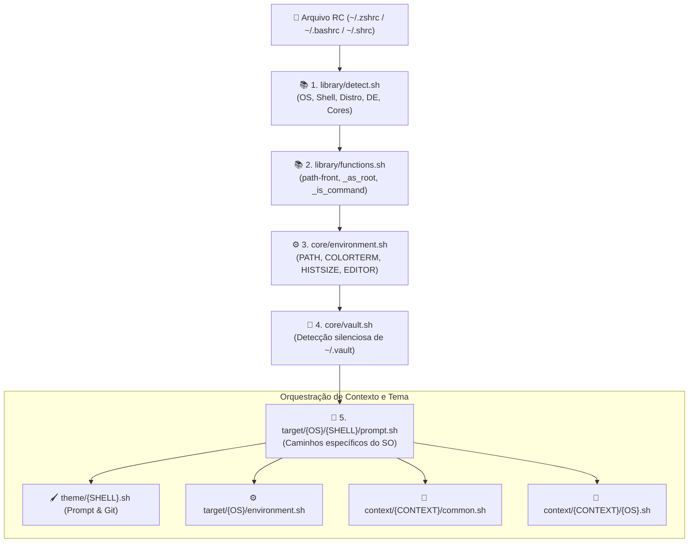
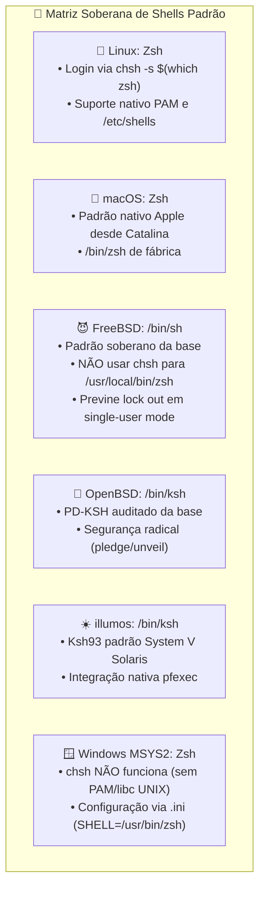
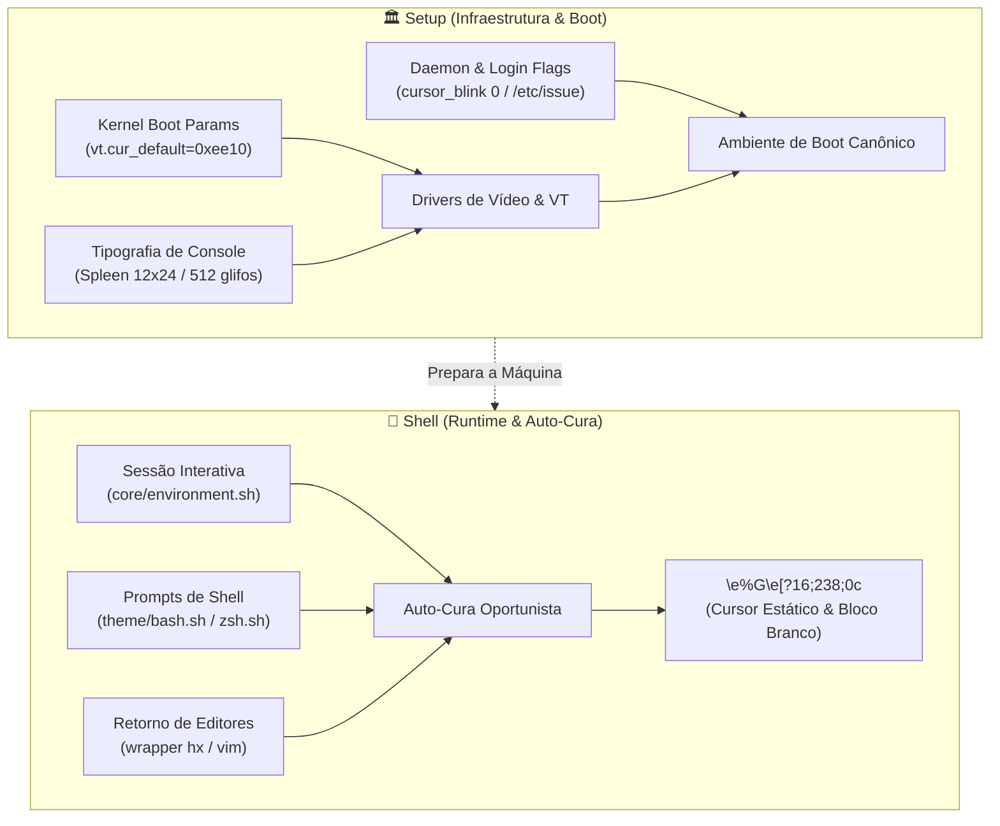
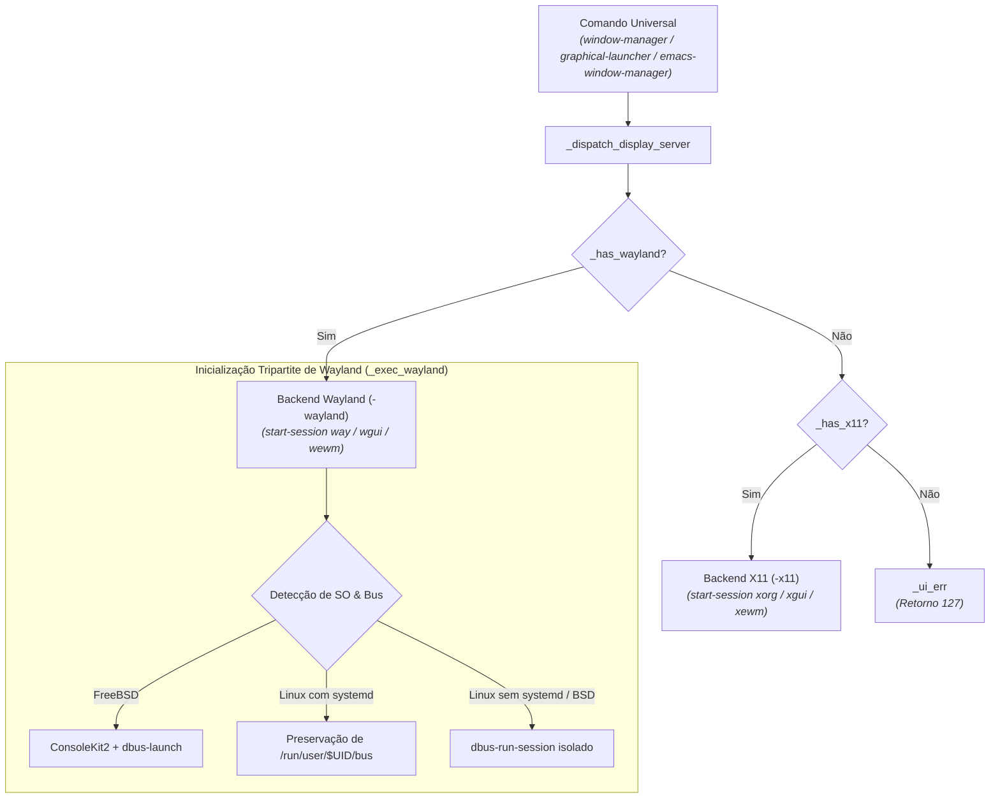

# 🏛️ Arquitetura & Ciclo de Vida do Universal Shell

O **Universal Shell Environment** é o motor de execução interativo do [Quarteto de Produtividade](https://github.com/GabrielFrigo4/setup). Ele foi concebido para entregar uma experiência de terminal idêntica e de alta velocidade em qualquer sistema operacional (**Linux**, **FreeBSD**, **macOS**, **Windows**).

---

## ⚡ Cascata de Inicialização (Boot Pipeline)

Ao abrir qualquer novo emulador de terminal, painel de multiplexador (`tmux`) ou conexão SSH, o arquivo de inicialização do shell (`.zshrc`, `.bashrc` ou `.shrc`) invoca o entrypoint modular do ecossistema:



### Ordem Estrita de Sourcing:

1. **`library/detect.sh`**: Executa sondagens em baixo nível para identificar o sistema hospedeiro sem gerar subprocessos desnecessários.
2. **`library/functions.sh`**: Exporta helpers universais (`path-front`, `path-back`, `_as_root`, `_is_command`) requeridos por todos os módulos subsequentes.
3. **`core/environment.sh`**: Define variáveis canônicas, sanitiza o `$PATH`, ativa suporte a TrueColor (24-bit RGB) e configura históricos persistentes.
4. **`core/vault.sh`**: Se o diretório `~/.vault` existir, injeta silenciosamente variáveis de ambiente privadas e chaves SSH.
5. **`target/{OS}/{SHELL}/prompt.sh`**: Carrega as customizações específicas da plataforma e compõe o tema visual.
6. **`context/{CONTEXT}/`**: Aplica atalhos e comportamentos específicos da carga de trabalho (`desktop`, `server`, `container` — com extensões WSL automáticas).

---

## ⏱️ Orçamento de Desempenho (<64ms, padrão $2^n$)

A regra máxima do Universal Shell é a **latência imperceptível** governada pelo padrão binário de potências de 2 ($2^n$). Nenhuma sessão deve demorar mais de 64 milissegundos (alvo `PASS`, com meta `ULTRA < 32ms`) para renderizar o primeiro prompt:

- **Zero Forks Excessivos:** Evita pipes pesados (`grep | awk | sed | cut`) durante o boot; utiliza expansões de parâmetro POSIX nativas sempre que possível.
- **Lazy Loading Estratégico:** Utilitários de terceiros pesados (como `sdkman`, `nvm` ou `pyenv`) não são carregados no boot da sessão, mas envelopados sob demanda.
- **Detecção em Cache de Memória:** Checagens de ambiente são mantidas no escopo da sessão, evitando leituras de disco redundantes.

---

## 🤫 A Regra do Silêncio (_Rule of Silence_)

Em conformidade com a filosofia UNIX:

> _"Um programa deve produzir apenas as saídas estritamente necessárias. Silêncio é ouro."_

- **Zero Banners / Zero Textos:** O terminal não exibe ASCII art, mensagens de boas-vindas, logs de inicialização ou contadores de pacotes ao abrir.
- **Suporte Perfeito a Ferramentas Remotas:** O silêncio absoluto no boot garante que ferramentas como `scp`, `sftp`, `rsync`, `ansible` e `git` operem sem falhas ou corrupção de fluxo de dados.

---

## 🛡️ Portabilidade POSIX vs. Shells Modernos

- **Camadas Base (`library/`, `core/`):** Escritas em estrita conformidade com o padrão **POSIX sh**. Devem rodar no `/bin/sh` nativo do FreeBSD sem nenhuma dependência de extensões do GNU Bash.
- **Prompts Especializados (`theme/`):**
    - **Zsh (`theme/zsh.sh`):** Utiliza o subsistema `zstyle`, `vcs_info` e autocompletion com menu interativo.
    - **Bash (`theme/bash.sh`):** Utiliza escape sequences nativas do Bash com suporte a cores 256/TrueColor e status Git.
    - **POSIX Sh (`theme/sh.sh`):** Prompt atômico, leve e sem dependências, exclusivo para o FreeBSD `/bin/sh`.
    - **KornShell (`theme/ksh.sh`):** Prompt ultra-leve calibrado para `/bin/ksh` no OpenBSD com controle defensivo `\x01` (0x01) e ANSI nativo.

---

## 🧭 Matriz de Shells Padrão & Política de Login (chsh vs. Nativo)

Cada sistema operacional no ecossistema possui uma política canônica para seu shell de login padrão, governada por princípios de resiliência, segurança e arquitetura de kernel:



### 1. 🐧 Linux (Desktop / Servidor)

- **Shell Padrão:** `zsh`.
- **Mecanismo:** `chsh -s "$(command -v zsh)"` (altera o campo 7 em `/etc/passwd`).
- **Justificativa:** O Linux possui suporte pleno a PAM (`pam_shells.so`), registros consolidados em `/etc/shells` e ecossistema robusto. É perfeitamente seguro e desejável definir o Zsh como shell de login interativo principal.

### 2. 🍎 macOS (Darwin / Mach)

- **Shell Padrão:** `zsh`.
- **Mecanismo:** Nativo de fábrica pela Apple (`/bin/zsh`) desde o macOS Catalina (10.15).
- **Justificativa:** O Zsh já é o shell padrão configurado no Open Directory (`dscl . -read /Users/$USER UserShell`), dispensando comandos manuais.

### 3. 😈 FreeBSD (Workstation & Server)

- **Shell Padrão:** `/bin/sh` (com `libedit`).
- **Por que NÃO usar `chsh` para `/usr/local/bin/zsh`?**
    - No FreeBSD, o sistema base é estritamente segregado dos pacotes externos. A base reside em `/bin` e `/sbin`, enquanto pacotes adicionais (`pkg`) vão para `/usr/local/bin`.
    - Frequentemente, `/usr` ou `/usr/local` residem em datasets ZFS ou partições que podem não estar montadas durante uma recuperação ou modo monousuário (_single-user mode_ / emergência).
    - Se a conta do usuário ou do `root` tiver seu shell de login configurado para `/usr/local/bin/zsh` no `/etc/passwd` e o `/usr/local` falhar ao montar, **o sistema entra em bloqueio imediato (_lock out_), impedindo qualquer login**.
    - O `/bin/sh` do FreeBSD é moderno, ultrarrápido e integra edição de linha e histórico via `libedit`. Ele é a âncora de segurança e estabilidade da máquina. O Zsh pode ser lançado sob demanda ou como sessão interativa do terminal gráfico, mas o shell de login na base permanece `/bin/sh`.

### 4. 🐡 OpenBSD (Segurança Pragmática)

- **Shell Padrão:** `/bin/ksh` (Public Domain Korn Shell).
- **Justificativa:** Segue a mesma filosofia de robustez do FreeBSD: o `/bin/ksh` faz parte da base auditada e imutável sob `pledge(2)` e `unveil(2)`. Pacotes em `/usr/local/bin` não devem ser requisitos para entrar no sistema em caso de falha de disco.

### 5. ☀️ illumos (OpenIndiana / SmartOS / OmniOS)

- **Shell Padrão:** `/bin/ksh` (Ksh93).
- **Justificativa:** Herança direta do Unix System V e Solaris. O ecossistema administrativo, scripts de inicialização SMF e wrappers de privilégios (`pfexec`) operam nativamente ao redor do Ksh.

### 6. 🪟 Windows MSYS2 (UCRT64)

- **Shell Padrão:** `zsh` (ou `bash`).
- **Por que o `chsh` NÃO funciona?**
    - O MSYS2 é uma camada de emulação POSIX rodando sobre as APIs do Windows NT Win32. Ele não possui daemon `login`, autenticação PAM, nem `/etc/passwd` nativo do kernel.
    - O utilitário `chsh` não existe no subsistema ou não surte efeito sobre novos processos de console instanciados pelo Windows.
- **Como configurar:** A definição do shell padrão no MSYS2 é declarativa:
    - Nos arquivos `.ini` da raiz do MSYS2 (`/ucrt64.ini`, `/clang64.ini`, `/msys2.ini`):
        ```ini
        SHELL=/usr/bin/zsh
        ```
    - Nas configurações do Windows Terminal ou Mintty, passando o argumento `-shell /usr/bin/zsh`.

---

## 🏛️ Camadas de Soberania: Setup vs Shell (Infraestrutura vs Auto-Cura)

O ecossistema estabelece uma divisão rigorosa de responsabilidades entre o provisionamento de infraestrutura do sistema operacional (**Setup**) e a operação do ambiente interativo de usuário (**Shell**):



### 1. Responsabilidade do Setup (Infraestrutura do SO)

O repositório **Setup** opera com privilégios de superusuário (`sudo`/`doas`) e governa o estado do hardware e do sistema operacional desde o boot:

- **Parâmetros de Kernel:** Injeta `vt.cur_default=0xee10` (`60944`) no GRUB e `systemd-boot`, estabelecendo o softcursor canônico para o subsistema VT do Linux.
- **Drivers de Console & Tipografia:** Instala e ativa as fontes bitmap de alta legibilidade (Spleen 12x24 / 512 glifos) via `vconsole.conf` (Linux) e `/etc/rc.conf` (FreeBSD).
- **Desativação de Pisque:** Configura `cursor_blink 0` via `systemd-tmpfiles` e limpa o terminal pré-login em `/etc/issue` no Linux; configura `allscreens_flags="-c normal,noblink"` no FreeBSD.
- O Setup garante que, antes mesmo do usuário autenticar, o console virtual já opere em alta resolução e com cursor estático.

### 2. Responsabilidade do Shell (Sessão & Auto-Cura)

O repositório **Universal Shell** opera no espaço de usuário desprivilegiado e governa a integridade da sessão interativa:

- **Resiliência contra Mutações de TUI:** Editores modais (Helix, Vim, Neovim) e aplicações TUI frequentemente alteram o cursor via sequências de controle DECSCUSR (`\e[?1 q` para bloco piscante, `\e[?5 q` para barra). Ao encerrar ou receber sinais (`SIGINT`), essas aplicações podem deixar o console em estado degradado.
- **Auto-Cura no Retorno de Ferramentas:** Wrappers de editores (como `hx()` em `context/desktop/common.sh`) capturam o código de retorno e reemitem a sequência de cura (`\e%G\e[?16;238;0c` em consoles puros `_is_raw_tty` ou `\e[0 q` em PTYs gráficos).
- **Auto-Cura no Ciclo de Prompt:** Na inicialização da sessão (`core/environment.sh`) e na renderização dos prompts (`theme/bash.sh`, `theme/zsh.sh`), o Shell assegura que o interpretador UTF-8 permaneça sincronizado (`\e%G`) e que o cursor mantenha-se em bloco estático e imune ao bug de deslocamento de cor das fontes de 512 glifos.

---

## 🖥️ Despachante Universal de Display Server & Arquitetura Tripartite

Para gerenciar o ciclo de vida gráfico sem acoplamento a servidores específicos, o Shell adota o padrão **Display Server Dispatcher**:



### 1. Simetria de Nomes & Desacoplamento

- **Comandos Universais:** `window-manager`, `graphical-launcher`, `emacs-window-manager`. Despacham dinamicamente para o backend gráfico disponível.
- **Especializações por Protocolo:** Sufixos `-wayland` e `-x11` mantêm autocompletion coeso no shell (`window-manager<TAB>` lista todas as opções).
- **Aliases Ergonômicos:**
    - Wayland: `wwm`, `way`, `wgui`, `wewm`.
    - X11: `xwm`, `xorg`, `x11`, `xgui`, `xewm`, `exwm`.
    - Universal: `wm`, `win`, `gui`, `ewm`.

### 2. Ciclo de Vida Tripartite do `_exec_wayland`

Ao iniciar ambientes gráficos nativos a partir de TTY, o encapsulamento de barramento D-Bus segue três caminhos mutuamente exclusivos:

1. **FreeBSD:** Encapsulado via `ck-launch-session dbus-launch --exit-with-session` para registrar o assento VT no ConsoleKit2.
2. **Linux com systemd (Fedora/Debian/Arch):** O socket `/run/user/$(id -u)/bus` gerado pelo PAM/systemd é detectado e preservado intacto, exportando `DBUS_SESSION_BUS_ADDRESS` e evitando a criação de barramentos isolados que corrompem alvos de sessão do GNOME (`gnome-session@gnome.target`).
3. **Linux sem systemd / BSDs alternativos (Devuan/Alpine/Void):** Invocado via `dbus-run-session` para fornecer barramento efêmero sem daemon de sessão residente.
