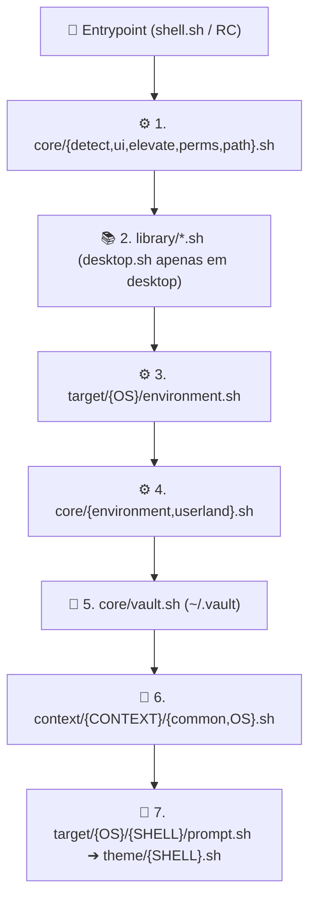
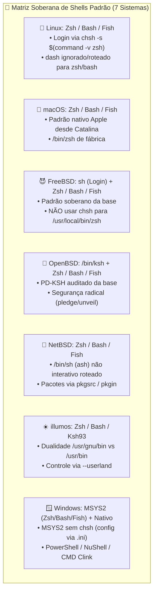
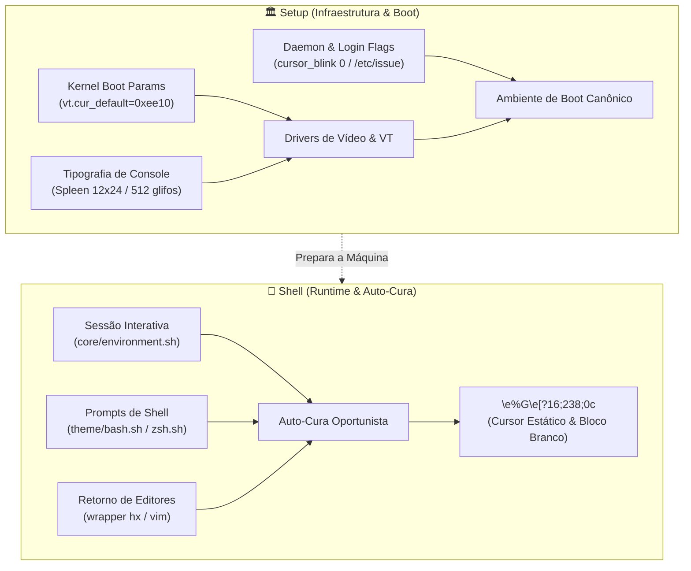
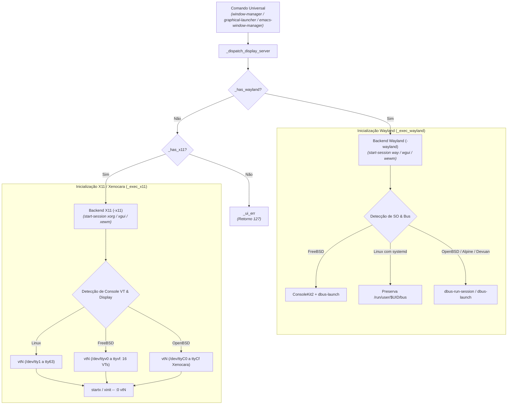

# 🏛️ Arquitetura & Ciclo de Vida do Universal Shell

O **Universal Shell Environment** é o motor de execução interativo do [Quarteto de Produtividade](https://github.com/GabrielFrigo4/setup). Ele foi concebido para entregar uma experiência de terminal idêntica e de alta velocidade em todas as 7 plataformas homologadas (**Linux**, **FreeBSD**, **OpenBSD**, **NetBSD**, **illumos**, **macOS** e **Windows**).

---

## ⚡ Cascata de Inicialização (Boot Pipeline)

Ao abrir qualquer novo emulador de terminal, painel de multiplexador (`tmux`) ou conexão SSH, o entrypoint do ecossistema (`shell.sh` / `init.sh` ou o bloco gerado em `~/.zshrc`, `~/.bashrc`, `~/.shrc`, `~/.kshrc`) executa uma cascata determinística de carregamento:



### Ordem Estrita de Sourcing & Auto-Cura:

1. **`core/` Fundação (`detect`, `ui`, `elevate`, `perms`, `path`):** Carrega o motor de detecção e cache, emissão semântica `_ui_*`, escalonamento `_as_root`, manipulação de `$PATH` e `_has_bin`/`_resolve_bin`. Em seguida, `_self_heal_perms` (e o `_install_repo_perms` no `install.sh`) assegura `0755` apenas nos entrypoints com `#!` (`shell.sh`, `init.sh`, `install.sh`, `benchmark.sh`, `.githooks/*` e `.scripts/*`), mantendo `0644` em todas as bibliotecas carregadas via `source` (`.`) e suportando diretórios `.git` e gitlinks de submódulos.
2. **`library/` Dispatchers & Lazy Desktop:** Carrega os dispatchers de domínio (`functions.sh`, `system.sh`, `ecosystem.sh`, `hypervisor.sh`) e carrega `library/desktop.sh` **exclusivamente** quando `SHELL_CONTEXT=desktop` (carregando `desktop/{detect,theme,emacs,apps}.sh` e registrando wrappers _lazy_ para `desktop/{device,kiosk,session}.sh`).
3. **`target/{OS}/environment.sh`:** Aplica caminhos e tunings nativos do SO (incluindo segregação `--userland` como `/usr/gnu/bin` e `MANPATH` no illumos).
4. **`core/environment.sh` & `core/userland.sh`:** Exporta `PYTHONPYCACHEPREFIX="${XDG_CACHE_HOME:-${HOME}/.cache}/pycache"` em todos os contextos, configura `_shell_ls` (com detecção de TTY vs pipe), `COLORTERM`, `EDITOR`/`VISUAL` e aliases universais, aplicando em seguida o motor dual-mode `--userland=default|bsd|gnu` via `core/userland.sh` (`core/deploy.sh` permanece exclusivo do `install.sh`).
5. **`core/vault.sh`:** Se `~/.vault` existir, injeta silenciosamente variáveis de ambiente privadas e chaves SSH sob carregamento _lazy_.
6. **`context/{CONTEXT}/{common,OS}.sh`:** Aplica variáveis e especializações do perfil ativo (`desktop`, `server`, `container` — com extensão `wsl.sh` quando aplicável). Em `desktop/common.sh`, aplica `_desktop_apply_theme_context` (de `library/desktop/theme.sh`) sem carregar as 4.600+ linhas de `library/desktop/session.sh` no boot.
7. **`target/{OS}/{SHELL}/prompt.sh` & `theme/{SHELL}.sh`:** Carrega o motor visual do shell e as regras de `target/common/{SHELL}/`. No Fish, o fluxo espelhado parte de `target/common/fish/config.fish` (`ui.fish`, `prompt.fish`, `aliases.fish`).

---

## ⏱️ Orçamento de Desempenho (<64ms, padrão $2^n$)

A regra máxima do Universal Shell é a **latência imperceptível** governada pelo padrão binário de potências de 2 ($2^n$). Nenhuma sessão deve demorar mais de 64 milissegundos (alvo `PASS`, com meta `ULTRA < 32ms`) para renderizar o primeiro prompt:

- **Zero Forks Excessivos:** Evita pipes pesados (`grep | awk | sed | cut`) durante o boot; utiliza expansões de parâmetro POSIX nativas sempre que possível.
- **Lazy Loading Estratégico:** Utilitários de terceiros pesados (como `sdkman`, `nvm` ou `pyenv`) não são carregados no boot da sessão, mas envelopados sob demanda.
- **Detecção em Cache de Memória:** Checagens de ambiente são mantidas no escopo da sessão, evitando leituras de disco redundantes.

---

## 🤫 A Regra do Silêncio (_Rule of Silence_)

Em conformidade com a filosofia UNIX:

> _"Um programa deve produzir apenas as saídas estritamente necessárias. Silêncio é ouro."_

- **Zero Banners / Zero Textos:** O terminal não exibe ASCII art, mensagens de boas-vindas, logs de inicialização ou contadores de pacotes ao abrir.
- **Suporte Perfeito a Ferramentas Remotas:** O silêncio absoluto no boot garante que ferramentas como `scp`, `sftp`, `rsync`, `ansible` e `git` operem sem falhas ou corrupção de fluxo de dados.

---

## 🛡️ Portabilidade POSIX vs. Shells Modernos

- **Camadas Base (`library/`, `core/`):** Escritas em estrita conformidade com o padrão **POSIX sh**. Devem rodar no `sh` nativo do FreeBSD sem nenhuma dependência de extensões do GNU Bash.
- **Segregação Userland (`--userland=default|bsd|gnu`):** Em modo `default` ou `bsd`, diretórios GNU (`gnubin` / `/usr/gnu/bin`) não são inseridos à frente do `$PATH`, preservando ferramentas nativas de BSD/illumos (`ls`, `stat`, `sed`). Em modo `gnu`, diretórios GNU reais assumem prioridade (mantendo `~/.local/bin` na liderança), acompanhados de cache dinâmico de aliases `g*` validados por `--version` e `_shell_ls` via `gls`. O `install.sh` persiste `export SHELL_USERLAND` in-place em `~/.profile`, `/root/.profile` e `~/.config/fish/config.fish`.
- **Prompts Especializados (`theme/` & `target/common/fish/`):**
    - **Zsh (`theme/zsh.sh`):** Utiliza `PROMPT_SUBST` com variáveis globais protegidas `_theme_ps1_*` e escape `%` ➔ `%%` para prevenir injeção de comandos/formatos sem perder glifos Nerd Font (`U+E000..U+F8FF`), além de autocompletion com menu interativo e hooks `precmd`.
    - **Bash (`theme/bash.sh`):** Protege expansões dinâmicas verificando `shopt -q promptvars` via variáveis `_theme_ps1_*` e delimitação `\[...\]` para cálculo exato no Readline.
    - **POSIX Sh (`theme/sh.sh`):** Prompt atômico, leve e sem dependências, exclusivo para o FreeBSD `sh`, com triggers protegendo exit code e evitando disparo duplo do `zoxide`.
    - **KornShell (`theme/ksh.sh`):** Prompt calibrado para OpenBSD `/bin/ksh` (`pdksh`/`oksh`) usando escape hexadecimal (`printf '\x1b'`) e delimitador `\x01\r` (zero notação octal).
    - **Fish (`target/common/fish/`):** Runtime modular (`config.fish`, `prompt.fish`, `ui.fish`, `aliases.fish`) configurado via `install.sh -s fish`.

---

## 🧭 Matriz de Shells Padrão & Política de Login (chsh vs. Nativo)

Cada sistema operacional no ecossistema possui uma política canônica para seu shell de login padrão, governada por princípios de resiliência, segurança e arquitetura de kernel:



> [!NOTE]
> **`dash` e NetBSD `/bin/sh` (`ash`) não são shells interativos suportados:** Tanto o `_detect_enabled_shell` quanto o `install.sh` e os guardas de compatibilidade dos arquivos RC promovem/roteiam automaticamente sessões interativas para `zsh` ou `bash`. O suporte ao `sh` interativo é exclusivo do FreeBSD `/bin/sh`.

### 1. 🐧 Linux (Desktop / Servidor)

- **Shell Padrão:** `zsh`.
- **Mecanismo:** `chsh -s "$(command -v zsh)"` (altera o campo 7 em `/etc/passwd`).
- **Justificativa:** O Linux possui suporte pleno a PAM (`pam_shells.so`), registros consolidados em `/etc/shells` e ecossistema robusto. É perfeitamente seguro e desejável definir o Zsh como shell de login interativo principal.

### 2. 🍎 macOS (Darwin / Mach)

- **Shell Padrão:** `zsh`.
- **Mecanismo:** Nativo de fábrica pela Apple (`/bin/zsh`) desde o macOS Catalina (10.15).
- **Justificativa:** O Zsh já é o shell padrão configurado no Open Directory (`dscl . -read /Users/$USER UserShell`), dispensando comandos manuais.

### 3. 😈 FreeBSD (Workstation & Server)

- **Shell Padrão:** `sh` (com `libedit`).
- **Por que NÃO usar `chsh` para `/usr/local/bin/zsh`?**
    - No FreeBSD, o sistema base é estritamente segregado dos pacotes externos. A base reside em `/bin` e `/sbin`, enquanto pacotes adicionais (`pkg`) vão para `/usr/local/bin`.
    - Frequentemente, `/usr` ou `/usr/local` residem em datasets ZFS ou partições que podem não estar montadas durante uma recuperação ou modo monousuário (_single-user mode_ / emergência).
    - Se a conta do usuário ou do `root` tiver seu shell de login configurado para `/usr/local/bin/zsh` no `/etc/passwd` e o `/usr/local` falhar ao montar, **o sistema entra em bloqueio imediato (_lock out_), impedindo qualquer login**.
    - O `sh` do FreeBSD é moderno, ultrarrápido e integra edição de linha e histórico via `libedit`. Ele é a âncora de segurança e estabilidade da máquina. O Zsh pode ser lançado sob demanda ou como sessão interativa do terminal gráfico, mas o shell de login na base permanece `sh`.

### 4. 🐡 OpenBSD (Segurança Pragmática)

- **Shell Padrão:** `/bin/ksh` (Public Domain Korn Shell).
- **Justificativa:** Segue a mesma filosofia de robustez do FreeBSD: o `/bin/ksh` faz parte da base auditada e imutável sob `pledge(2)` e `unveil(2)`. Pacotes em `/usr/local/bin` não devem ser requisitos para entrar no sistema em caso de falha de disco.

### 5. 🚩 NetBSD (Portabilidade & `pkgsrc`)

- **Shells Interativos:** `zsh`, `bash`, `fish` (via `pkgsrc`/`pkgin`).
- **Política para `/bin/sh` (`ash`):** O `/bin/sh` nativo do NetBSD (`NETBSD_SHELL`) não é um shell interativo suportado pela suíte. Guardas em `~/.shrc`, `~/.kshrc`, `install.sh` e `target/freebsd/sh/terminal.sh` roteiam/promovem sessões interativas automaticamente para `zsh` ou `bash`.

### 6. ☀️ illumos (OpenIndiana / SmartOS / OmniOS)

- **Shells Interativos & Sistema:** `zsh`, `bash`, `fish`, além do `/bin/ksh` (`ksh93`) padrão System V / SMF com `pfexec`.
- **Dualidade Userland:** `target/illumos/environment.sh` move `/usr/gnu/bin` para o final do `$PATH` (e reordena `MANPATH`) nos modos `default`/`bsd`, ativando precedência GNU apenas sob `--userland=gnu`.

### 7. 🪟 Windows (MSYS2 UCRT64 + Shells Nativos)

- **Shell Padrão:** `zsh` (ou `bash`).
- **Por que o `chsh` NÃO funciona?**
    - O MSYS2 é uma camada de emulação POSIX rodando sobre as APIs do Windows NT Win32. Ele não possui daemon `login`, autenticação PAM, nem `/etc/passwd` nativo do kernel.
    - O utilitário `chsh` não existe no subsistema ou não surte efeito sobre novos processos de console instanciados pelo Windows.
- **Como configurar:** A definição do shell padrão no MSYS2 é declarativa:
    - Nos arquivos `.ini` da raiz do MSYS2 (`/ucrt64.ini`, `/clang64.ini`, `/msys2.ini`):
        ```ini
        SHELL=/usr/bin/zsh
        ```
    - Nas configurações do Windows Terminal ou Mintty, passando o argumento `-shell /usr/bin/zsh`.

---

## 🏛️ Camadas de Soberania: Setup vs Shell (Infraestrutura vs Auto-Cura)

O ecossistema estabelece uma divisão rigorosa de responsabilidades entre o provisionamento de infraestrutura do sistema operacional (**Setup**) e a operação do ambiente interativo de usuário (**Shell**):



### 1. Responsabilidade do Setup (Infraestrutura do SO)

O repositório **Setup** opera com privilégios de superusuário (`sudo`/`doas`) e governa o estado do hardware e do sistema operacional desde o boot:

- **Parâmetros de Kernel:** Injeta `vt.cur_default=0xee10` (`60944`) no GRUB e `systemd-boot`, estabelecendo o softcursor canônico para o subsistema VT do Linux.
- **Drivers de Console & Tipografia:** Instala e ativa as fontes bitmap de alta legibilidade (Spleen 12x24 / 512 glifos) via `vconsole.conf` (Linux) e `/etc/rc.conf` (FreeBSD).
- **Desativação de Pisque:** Configura `cursor_blink 0` via `systemd-tmpfiles` e limpa o terminal pré-login em `/etc/issue` no Linux; configura `allscreens_flags="-c normal,noblink"` no FreeBSD.
- O Setup garante que, antes mesmo do usuário autenticar, o console virtual já opere em alta resolução e com cursor estático.

### 2. Responsabilidade do Shell (Sessão & Auto-Cura)

O repositório **Universal Shell** opera no espaço de usuário desprivilegiado e governa a integridade da sessão interativa:

- **Resiliência contra Mutações de TUI:** Editores modais (Helix, Vim, Neovim) e aplicações TUI frequentemente alteram o cursor via sequências de controle DECSCUSR (`\e[?1 q` para bloco piscante, `\e[?5 q` para barra). Ao encerrar ou receber sinais (`SIGINT`), essas aplicações podem deixar o console em estado degradado.
- **Auto-Cura no Retorno de Ferramentas:** Wrappers de editores (como `hx()` e `_restore_tty_cursor` em `library/desktop/apps.sh`) capturam o código de retorno e reemitem a sequência de cura (`\e%G\e[?16;238;0c` em consoles puros `_is_raw_tty` Linux ou `\e[1 q\e]112\a\e]112\e\\` em PTYs gráficos).
- **Recuperação Segura do Daemon Emacs (`.scripts/emacs-client`):** Em vez de encerrar processos indiscriminadamente com `pkill -9 -x emacs`, o entrypoint `.scripts/emacs-client` (e `_emacs_ensure_healthy_daemon` em `library/desktop/emacs.sh`) executa um probe não-bloqueante (`timeout 2 emacsclient -e '(+ 1 1)'`) sobre o socket `EMACS_SOCKET_NAME`, limpando processos/sockets órfãos somente quando o daemon não responde.
- **Auto-Cura no Ciclo de Prompt:** Na inicialização da sessão (`core/environment.sh`) e na renderização dos prompts (`theme/{bash,zsh,sh,ksh}.sh`), o Shell assegura que o interpretador UTF-8 permaneça sincronizado (`\e%G` em Linux VT ou `\e[1 q` em PTY) e que o cursor mantenha-se em bloco estático imune ao bug de deslocamento cromático das fontes de 512 glifos.

---

## 🖥️ Despachante Universal de Display Server & Inicialização Multi-SO

Para gerenciar o ciclo de vida gráfico sem acoplamento a servidores específicos, o Shell adota o padrão **Display Server Dispatcher**:



### 1. Padrão Canônico de Nomenclatura & Simetria em 3 Camadas

O ecossistema impõe uma regra inegociável de separação entre funções de runtime e atalhos de terminal:

- **Funções Canônicas (Kebab-Case por Extenso):**
    - Universal: `<função>` (ex: `window-manager`, `graphical-launcher`, `emacs-window-manager`). Despacha via `_dispatch_display_server "<função>"`.
    - Wayland: `<função>-wayland` (ex: `window-manager-wayland`, `graphical-launcher-wayland`, `emacs-window-manager-wayland`).
    - X11: `<função>-x11` (ex: `window-manager-x11`, `graphical-launcher-x11`, `emacs-window-manager-x11`).
    - _Vantagem Arquitetural:_ O autocompletion no terminal (`<função><TAB>`) agrupa todas as implementações sob o mesmo prefixo sem poluir o namespace.

- **Aliases Ergonômicos (CLI):**
    - Universal: `<comando>` (ex: `wm`, `win`, `gui`, `ewm`, `ew`).
    - Wayland: `w<comando>` (ex: `wwm`, `way`, `wayland`, `wgui`, `wewm`, `wew`).
    - X11: `x<comando>` (ex: `xwm`, `xorg`, `x11`, `xgui`, `xewm`, `xew`, `exwm`).

### 2. Ciclo de Vida Multi-SO do `_exec_wayland`

Ao iniciar compositores Wayland a partir do console puro (TTY), o encapsulamento de barramento e assento segue três vias adaptativas:

1. **FreeBSD Workstation:** Encapsulado via `dbus-run-session -- ck-launch-session <script>` (fallback `dbus-launch --exit-with-session`) para vincular ao assento ConsoleKit2 e gerenciar hardware DRM via `seatd`. O `ck-launch-session` rejeita qualquer argumento iniciado por `-`, por isso recebe apenas um script de comando sem opções.
2. **Linux com systemd (Fedora/Debian/Arch):** O socket `/run/user/$(id -u)/bus` gerado pelo PAM/systemd é detectado e preservado intacto, exportando `DBUS_SESSION_BUS_ADDRESS`. Isso previne a criação de barramentos isolados que causam falhas fatais em alvos de sessão do GNOME (`gnome-session@gnome.target`).
3. **OpenBSD & Linux sem systemd (Devuan/Alpine/Void):** Invocado via `dbus-run-session` ou fallback defensivo `dbus-launch --exit-with-session`, garantindo que sessões em sistemas sem daemon de usuário recebam IPC funcional.

### 3. Ciclo de Vida Multi-SO do `_exec_x11`

Ao iniciar servidores X11 ou aplicações via `xinit` a partir do console, o `_exec_x11` unifica o tratamento de recursos e terminais virtuais:

1. **Fusão de Recursos:** Carrega automaticamente `~/.Xresources` via `xrdb -merge` antes de disparar o servidor.
2. **Resolução Dinâmica e Universal de VT (Virtual Terminal):**
    - **Linux:** Mapeia qualquer console `/dev/tty[0-9]+` (de `tty1` até `tty63`) para o argumento `vtN` correspondente.
    - **FreeBSD:** Mapeia todos os 16 consoles virtuais padrão `/dev/ttyv0` a `/dev/ttyvf` (índice hexadecimal avaliado dinamicamente via aritmética POSIX `$(( 0x${hex} + 1 ))`) para `vt1` a `vt16`. Também executa auto-cura de redesenho de console com `_freebsd_vt_bounce` (`vidcontrol -s`).
    - **OpenBSD (Xenocara):** Mapeia todas as telas do driver wscons `/dev/ttyC0` a `/dev/ttyCf` (hexadecimal avaliado via `$(( 0x${hex} + 1 ))`) para `vt1` a `vt16`.
3. **Cascata de Execução:** Dispara prioritariamente `startx` com fallback para `xinit` e preservação de `${DISPLAY:-:0}`.

### 4. Filosofia & Arquitetura dos Lançadores Efêmeros Multi-TTY (`gui` / `wgui` / `xgui`)

Diferente do paradigma tradicional onde um Display Manager pesado (GDM, SDDM, LightDM) monopoliza o hardware da estação de trabalho, o Universal Shell adota a **filosofia antifrágil dos processos gráficos efêmeros**:

- **A Interface Gráfica como Processo Filho de TTY:** O compositor gráfico é iniciado como um processo subordinado a um terminal virtual específico (`/dev/ttyN` no Linux ou `/dev/ttyvN` no FreeBSD).
- **Isolamento Concorrente Multi-TTY:** O usuário pode manter múltiplos ambientes e aplicativos gráficos completamente isolados em TTYs diferentes:
    - **TTY1:** Console puro de administração e monitoramento do sistema (`btm`, `htop`).
    - **TTY2:** `gui -k firefox` (Firefox rodando sob Sway com estética e tema KDE Plasma).
    - **TTY3:** `gui foot` (Terminal Foot rodando isolado em Wayland com estética GNOME).
    - **TTY4:** `gui -x gimp` (GIMP rodando sob XFCE).
    - **Troca Instantânea de Sessão:** A comutação entre ambientes é feita pelo kernel via `Ctrl+Alt+F1` a `Ctrl+Alt+F12`, sem overhead de virtualização ou containers.
- **Ciclo de Auto-Exit e Restauração Limpa:**
    - Ao fechar a aplicação gráfica (`_app`), o script efêmero emite o comando de saída do compositor (`swaymsg exit`, `riverctl exit` ou encerramento do `xinit`).
    - O compositor gráfico é encerrado e o terminal virtual retorna instantaneamente ao prompt interativo limpo do Shell.
    - No FreeBSD, o `_freebsd_vt_bounce` executa um chaveamento de VT via `vidcontrol -s` para forçar o redesenho do framebuffer do console do kernel, eliminando artefatos residuais de vídeo.
- **Por que Sway, Labwc e River com Fullscreen Automático são a Tétrade Wayland:**
    - O **Sway** é o micro-compositor primário: suporta aceleração gráfica via wlroots e atalhos de kernel para troca de TTY (`Ctrl+Alt+F*`). Para preservar o paradigma de quiosque e evitar divisões indesejadas de tela (split 50/50 ao abrir janelas filhas ou editores), a configuração efêmera do Sway injeta regras de quiosque automático (`for_window [app_id=".*"] fullscreen enable` e `for_window [class=".*"] fullscreen enable`), garantindo tela cheia contínua.
    - O **Labwc** atua como segundo fallback moderno: gera um `rc.xml` efêmero com `<windowRules><windowRule identifier="*" serverDecoration="no"><action name="Maximize"/></windowRule></windowRules>`, maximizando qualquer janela sem bordas nem decorações, com suporte nativo à troca de TTY.
    - O **River** é o terceiro fallback: inicializado intencionalmente sem o gerador de tiling (`rivertile`), o que impede o fatiamento da tela, abrindo as janelas empilhadas no topo (`default-attach-mode top`) com tecla rápida `Super+F` para fullscreen e troca de TTY preservada.
    - O **Cage** é mantido como último fallback defensivo de quiosque puro mono-aplicação, reservado para quando nenhum outro micro-compositor estiver disponível (devido à sua limitação de não comutar TTYs).
- **Paridade Estrita no X11 (`xgui` com `xterm`, `xrdb` e Cascata de Quiosque):**
    - O lançador `xgui` espelha rigorosamente o comportamento do `wgui`, utilizando o **XTerm** com a paleta Adwaita Dark do Foot, tipografia `JetBrainsMono Nerd Font` e padding interno de 16px.
    - O script efêmero do cliente do `xinit` injeta `~/.Xresources` via `xrdb -merge` após a subida do servidor X e dispara o XTerm com `-maximized`, ocupando 100% da resolução do monitor.
    - **Cascata de Quiosque em X11:** Para assegurar que qualquer aplicativo (Firefox, VLC, GIMP, Emacs) ocupe a tela inteira mesmo sem um Desktop Environment pesado, o `xinit` inicializa uma cascata de micro-gerenciadores de quiosque:
        1. **`matchbox-window-manager`:** Quiosque estrito de 1 janela em tela cheia sem bordas.
        2. **`openbox` efêmero:** Carrega regras com `<maximized>yes</maximized>` e `<decorations>no</decorations>` para todas as classes (`*`).
        3. **`cwm` (OpenBSD Xenocara):** Micro-gerenciador padrão limpo nativo dos alvos BSD.
        4. **`ratpoison`:** Gerenciador sem mouse onde cada janela ocupa 100% do display.
        5. **Micro-Daemon `xdotool`:** Como último fallback defensivo, um loop inofensivo em background redimensiona novas janelas para 100% da resolução.
    - Aplicações filhas e editores (como `emacs`) nascem automaticamente com parâmetros de frame maximizados (`-F "((fullscreen . maximized))"`).
- **Detecção e Sobrescrita de Temas de Desktop:**
    - O despachante inspeciona `$XDG_CURRENT_DESKTOP` e a hierarquia de ambientes instalados (GNOME > KDE > Cinnamon > MATE > XFCE > Adwaita).
    - Flags explícitas (`-g`, `-k`, `-x`, `-m`, `-c`) permitem forçar temas GTK, estilos Qt e cursores específicos para a aplicação em tempo de execução.
