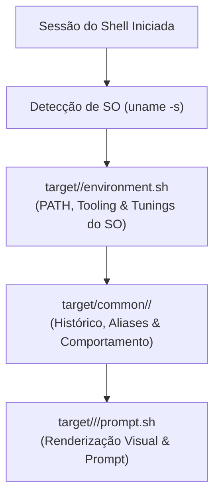

# 🎯 target/ — Especializações por Sistema Operacional & Interpretador

> O diretório `target/` concentra a camada de especialização do **Universal Shell**, adaptando o ambiente terminal, variáveis de sistema, caminhos de pacotes e prompts para cada sistema operacional hospedeiro e família de shell.

---

## 🧭 Arquitetura de Inicialização

O ciclo de bootstrapping desacopla o comportamento comum da plataforma física:

1. **`target/<os>/environment.sh`:** Carrega variáveis de ambiente, caminhos nativos (`/usr/local`, `/opt/homebrew`, MSYS2) e integrações de hypervisor/emulação.
2. **`target/common/<shell>/`:** Injeta configurações de histórico, navegação segura e edição de linha compartilhadas entre todos os SOs.
3. **`target/<os>/<shell>/prompt.sh`:** Ativa o tema visual e recursos interativos respeitando o limite de latência (<64ms).

---

## 📁 Catálogo de Plataformas Suportadas

| Plataforma  | `uname -s`        | Shells Suportados                          | Módulos e Especializações                                                                     |
| :---------- | :---------------- | :----------------------------------------- | :-------------------------------------------------------------------------------------------- |
| **FreeBSD** | `FreeBSD`         | `zsh`, `bash`, `sh`, `fish`                | Baseline POSIX `sh` (`editrc`, `terminal.sh`, `behavior.sh`), Bhyve (`bhyve.sh`), `compat.sh` |
| **Linux**   | `Linux`           | `zsh`, `bash`, `fish`                      | GNU Coreutils, systemd/OpenRC, D-Bus (`dash` roteado para `zsh`/`bash`)                       |
| **macOS**   | `Darwin`          | `zsh`, `bash`, `fish`                      | Homebrew (`/opt/homebrew` Apple Silicon vs `/usr/local` Intel), `pbcopy`/`pbpaste`            |
| **Windows** | `MINGW*`, `MSYS*` | `pwsh`, `nu`, `cmd`, `zsh`, `bash`, `fish` | PowerShell 7+, NuShell nativo, CMD via Clink (`%LOCALAPPDATA%\clink`), MSYS2 UCRT64           |
| **OpenBSD** | `OpenBSD`         | `ksh` (`oksh`), `zsh`, `bash`, `fish`      | Korn Shell canônico (`target/openbsd/ksh/` com hex `\x1b` e `\x01\r`), `doas`                 |
| **NetBSD**  | `NetBSD`          | `zsh`, `bash`, `fish`                      | Ecossistema `pkgsrc`/`pkgin` (`/bin/sh` `ash` não interativo roteado para `zsh`/`bash`)       |
| **illumos** | `SunOS`           | `zsh`, `bash`, `fish` (sistema `ksh93`)    | `--userland=default\|bsd\|gnu` (`/usr/gnu/bin` + `MANPATH`), ZFS e SMF                        |
| **Comum**   | `*` (Universal)   | `sh`, `bash`, `zsh`, `fish`, `ksh`         | Diretório `common/` (`0644` `sourced`) com `session.sh` e subpastas modulares                 |

> [!NOTE]
> Todas as bibliotecas em `target/` mantêm permissão `0644` (carregadas via `source`/`.`). No FreeBSD, `bhyve.sh` integra a VM Linux utilizando `BHYVE_LINUX_IP` / `BHYVE_LINUX_USER` / `BHYVE_LINUX_VM` / `BHYVE_LINUX_WORKDIR` (sem IPs ou nomes de usuário fixos). No illumos, `environment.sh` move `/usr/gnu/bin` para o final de `$PATH` e reordena `MANPATH` em `default`/`bsd`, priorizando GNU apenas em `--userland=gnu`.

---

## 📂 Organização por Shell Comum (`target/common/`) & Windows (`target/windows/`)

Cada família de interpretador possui um subdiretório dedicado sob [`target/common/`](common/) (além dos perfis nativos Windows em `target/windows/`):

- **[`common/sh/`](common/sh/):** Shells estritamente POSIX (`sh`), edição Emacs e histórico seguro `0600`.
- **[`common/bash/`](common/bash/):** Configurações de histórico compartilhado, `autocd`, `checkwinsize` e completions.
- **[`common/zsh/`](common/zsh/):** Histórico compartilhado em tempo real, expansão estendida e cache de completion (`.zwc`).
- **[`common/fish/`](common/fish/):** Runtime modular (`config.fish`, `prompt.fish`, `ui.fish`, `aliases.fish`) com `PYTHONPYCACHEPREFIX` e `SHELL_USERLAND`.
- **[`common/ksh/`](common/ksh/):** Korn Shell / OpenBSD `oksh` com edição de linha Emacs e histórico unificado (`~/.ksh_history`).
- **[`windows/powershell/`](windows/powershell/):** Perfis PowerShell (`profile.ps1`, `Microsoft.PowerShell_profile.ps1`) com `.NET` Registry e lazy Chocolatey.
- **[`windows/nushell/`](windows/nushell/):** Configuração NuShell (`env.nu`, `config.nu`) com `ENV_CONVERSIONS` dual e `registry query`.
- **[`windows/cmd/`](windows/cmd/):** Inicialização CMD + Clink (`autorun.cmd`, `setup-profile.reg`, `profile.cmd`, `profile.lua`) sem `io.popen` no boot.
