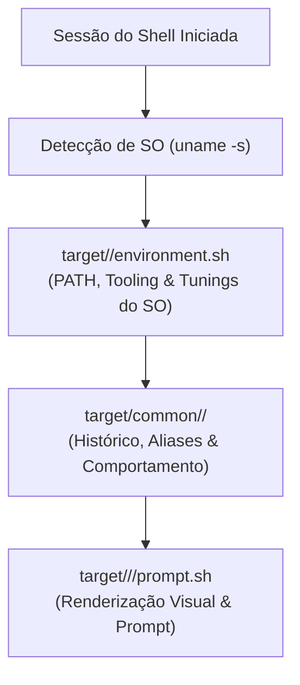

# 🎯 target/ — Especializações por Sistema Operacional & Interpretador

> O diretório `target/` concentra a camada de especialização do **Universal Shell**, adaptando o ambiente terminal, variáveis de sistema, caminhos de pacotes e prompts para cada sistema operacional hospedeiro e família de shell.

---

## 🧭 Arquitetura de Inicialização

O ciclo de bootstrapping desacopla o comportamento comum da plataforma física:

1. **`target/<os>/environment.sh`:** Carrega variáveis de ambiente, caminhos nativos (`/usr/local`, `/opt/homebrew`, MSYS2) e integrações de hypervisor/emulação.
2. **`target/common/<shell>/`:** Injeta configurações de histórico, navegação segura e edição de linha compartilhadas entre todos os SOs.
3. **`target/<os>/<shell>/prompt.sh`:** Ativa o tema visual e recursos interativos respeitando o limite de latência (<64ms).

---

## 📁 Catálogo de Plataformas Suportadas

| Plataforma  | `uname -s`        | Shells Suportados                  | Módulos e Especializações                                                          |
| :---------- | :---------------- | :--------------------------------- | :--------------------------------------------------------------------------------- |
| **FreeBSD** | `FreeBSD`         | `zsh`, `bash`, `sh`                | Baseline POSIX `/bin/sh`, Bhyve VM Linux (`bhyve.sh`), compatibilidade Linux, ZFS  |
| **Linux**   | `Linux`           | `zsh`, `bash`                      | GNU Coreutils, systemd/OpenRC, D-Bus, paridade POSIX e GNU                         |
| **macOS**   | `Darwin`          | `zsh`, `bash`                      | Homebrew (`/opt/homebrew` Apple Silicon vs `/usr/local` Intel), `pbcopy`/`pbpaste` |
| **Windows** | `MINGW*`, `MSYS*` | `pwsh`, `nu`, `cmd`, `zsh`, `bash` | PowerShell 7+, NuShell nativo, CMD via Clink + Lua, UCRT64/MSYS2                   |
| **OpenBSD** | `OpenBSD`         | `ksh` (`oksh`), `zsh`, `bash`      | Korn Shell canônico (`target/openbsd/ksh/`), permissões restritas e `doas`         |
| **NetBSD**  | `NetBSD`          | `zsh`, `bash`                      | Almquist `/bin/sh`, ecossistema `pkgsrc`/`pkgin` e `libedit`                       |
| **illumos** | `SunOS`           | `zsh`, `bash`                      | Kernel SVR4 moderno, dualidade `/usr/gnu/bin` vs `/usr/bin`, ZFS e SMF             |
| **Comum**   | `*` (Universal)   | `sh`, `bash`, `zsh`, `fish`, `ksh` | Diretório `common/` modularizado por pastas com simetria estrutural total          |

---

## 📂 Organização por Shell Comum (`target/common/`)

Cada família de interpretador possui um subdiretório dedicado sob [`target/common/`](common/):

- **[`common/sh/`](common/sh/):** Shells estritamente POSIX (`/bin/sh`), edição Emacs e histórico seguro `0600`.
- **[`common/bash/`](common/bash/):** Configurações de histórico compartilhado, `autocd`, `checkwinsize` e completions.
- **[`common/zsh/`](common/zsh/):** Histórico compartilhado em tempo real, expansão estendida e cache de completion (`.zwc`).
- **[`common/fish/`](common/fish/):** Runtime modular (`config.fish`, `prompt.fish`, `ui.fish`, `aliases.fish`).
- **[`common/ksh/`](common/ksh/):** Korn Shell / OpenBSD `oksh` com edição de linha e histórico unificado.
